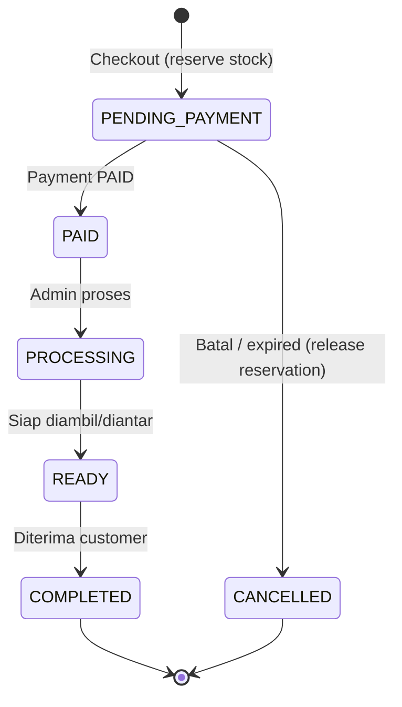
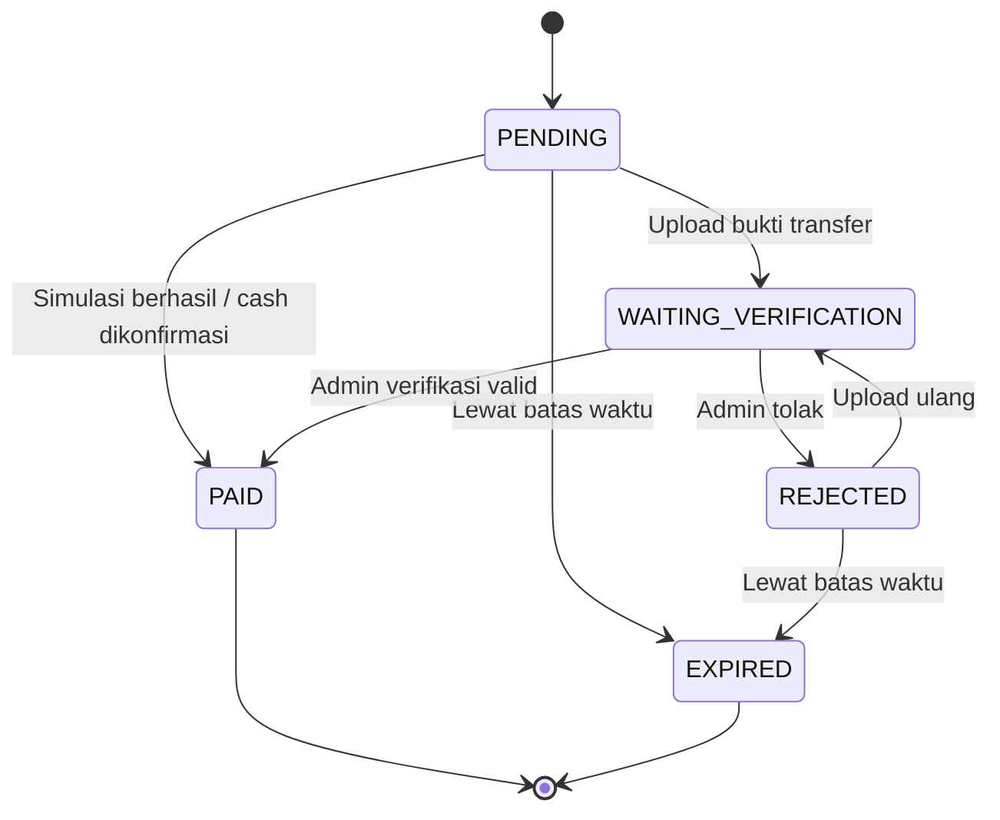
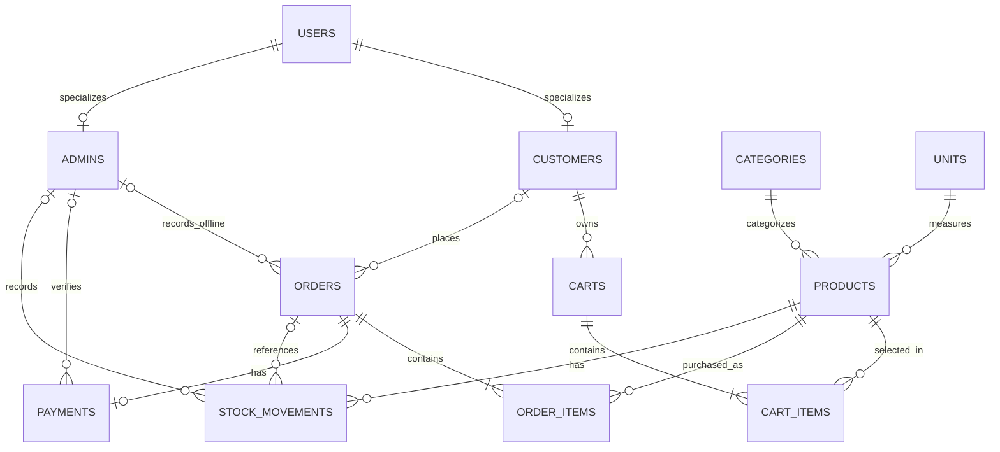
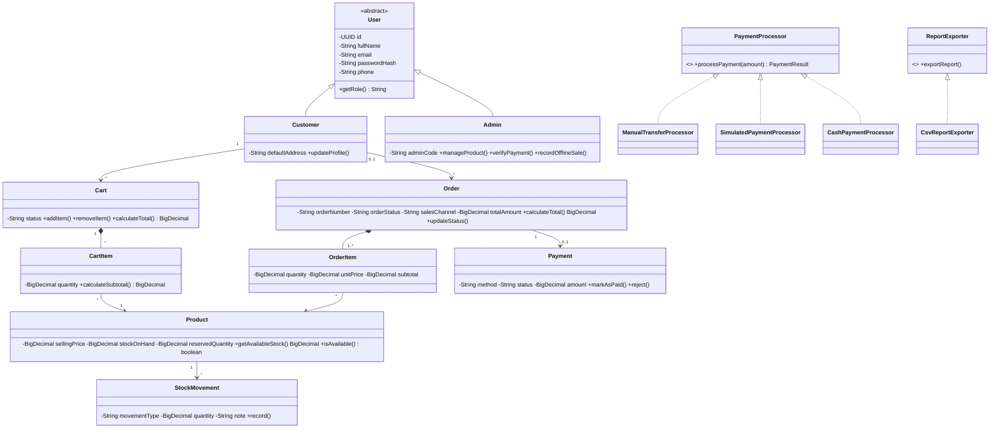
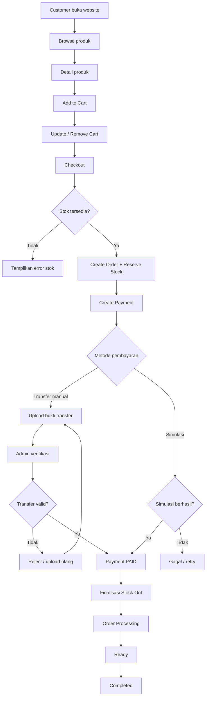
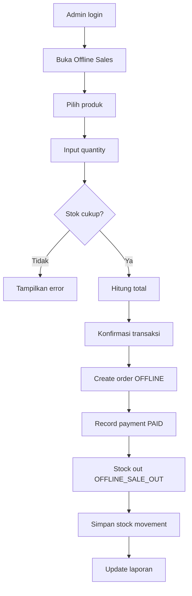

# PRODUCT REQUIREMENT DOCUMENT (PRD)

# ENSTEINSTORE
### E-Commerce & Sales Management Web Application — Toko Enstein

> *Your Trusted Store for Rainwear Materials and Accessories.*

---

## 0. Kontrol Dokumen

| Atribut | Keterangan |
| --- | --- |
| Nama produk | ENSTEINSTORE |
| Jenis produk | Web-Based E-Commerce & Sales Management System (Single-Seller) |
| Versi dokumen | 1.0 |
| Tanggal dokumen | 11 November 2026 |
| Status | Draft final — siap menjadi acuan pengembangan |
| Pemilik bisnis | Toko Enstein |
| Tim pengembang | Kelompok 05 |
| Konteks akademik | Final project mata kuliah Pemrograman Berorientasi Objek (PBO, 3 SKS) dan Basis Data (4 SKS), Semester 3 |
| Dokumen sumber | (1) Konsep Lengkap Website Application ENSTEINSTORE; (2) Rancangan Teknis berdasarkan RPS OOP & Basis Data; (3) Rancangan SRS, Business Rules, Arsitektur, ERD/EER, Class Diagram, API, dan Pengujian |
| Dokumen turunan yang direncanakan | SRS.md, ERD/EERD, Relational Schema, UML Class Diagram, OpenAPI spec, AGENTS.md |

### 0.1 Riwayat Revisi

| Versi | Tanggal | Perubahan |
| --- | --- | --- |
| 1.0 | 11 Nov 2026 | Penyusunan PRD awal dengan menyatukan tiga dokumen sumber |

### 0.2 Cara Membaca Dokumen Ini

- Dokumen ini adalah **satu sumber kebenaran (single source of truth)** yang merangkum tiga dokumen sumber. Jika ada perbedaan antar dokumen sumber, keputusan yang dipakai dicatat di **Bagian 25 (Decision Log)**.
- ID kebutuhan (`FR-xx`, `NFR-xx`, `BR-xx`) dipertahankan sama dengan dokumen SRS sumber agar mudah dilacak.
- Prioritas memakai skala **MoSCoW**: **M** (Must), **S** (Should), **C** (Could), **W** (Won't, di luar scope).
- Hal yang **bukan** keputusan dari dokumen sumber, melainkan asumsi/rekomendasi tambahan penyusun PRD, diberi label **[Asumsi]** dan dikumpulkan di Bagian 25.

---

## 1. Ringkasan Eksekutif

ENSTEINSTORE adalah aplikasi web yang mendigitalkan penjualan **Toko Enstein**, toko yang menjual bahan jas hujan dan komponen pendukungnya (kain/material PVC, kancing, resleting, karet, dan aksesori). Aplikasi memiliki **dua sisi** yang memakai satu backend dan satu database yang sama:

1. **Client Side (Customer):** melihat katalog, memilih produk, mengelola keranjang, checkout, membayar, dan memantau pesanan.
2. **Admin/Owner Side:** mengelola produk dan kategori, memverifikasi pembayaran, memproses pesanan, mengontrol stok, mencatat barang masuk dan penyesuaian, mencatat penjualan offline di toko, serta melihat dashboard dan laporan penjualan otomatis.

**Prinsip produk:**

> *Sederhana untuk pelanggan, lengkap untuk pemilik toko, dan terintegrasi pada database.*

**Alur bisnis inti:**

```
Product → Cart → Checkout → Payment → Order → Stock → Sales Report
```

**Pilihan teknologi (terkunci):** Next.js + TypeScript + Tailwind CSS + shadcn/ui (frontend), Java 25 LTS + Spring Boot 4.1.x + Maven (backend), PostgreSQL 18.x lokal via Docker + Flyway (database), komunikasi REST API, arsitektur three-tier.

**Dua nilai utama produk:**

- **Nilai bisnis:** transaksi, pembayaran, stok, dan laporan tercatat otomatis dalam satu database sehingga informasi stok akurat dan laporan penjualan tidak lagi bergantung pada pencatatan manual.
- **Nilai akademik:** menjadi studi kasus nyata yang membuktikan penerapan materi PBO (Java OOP) dan Basis Data (ER/EER, normalisasi, SQL lanjutan, transaksi) pada satu sistem yang sama.

---

## 2. Latar Belakang dan Problem Statement

### 2.1 Kondisi Saat Ini (As-Is)

Toko Enstein menjalankan penjualan dan pengelolaan stok secara manual. Penjualan hanya terjadi langsung di toko, pelanggan harus datang atau menghubungi pegawai untuk menanyakan produk dan menghitung pesanan.

### 2.2 Masalah dan Solusi

| # | Permasalahan Toko Enstein | Dampak | Solusi di ENSTEINSTORE |
| --- | --- | --- | --- |
| P1 | Belum memiliki penjualan online | Pelanggan harus datang/menghubungi toko | E-commerce website (katalog, cart, checkout) |
| P2 | Data produk tidak terstruktur | Sulit mengelola harga, satuan, dan deskripsi | Product & Category Management |
| P3 | Pencatatan stok manual | Stok sering salah | Inventory Management otomatis |
| P4 | Informasi stok sering tidak akurat | Salah janji ke pelanggan, stok minus | Stock monitoring + stock movement + reservasi stok |
| P5 | Transaksi tidak tercatat baik | Riwayat tidak dapat ditelusuri | Order & Payment Management |
| P6 | Laporan penjualan sering salah | Keputusan bisnis tidak akurat | Automatic Sales Reporting dari data transaksi |
| P7 | Sulit memantau barang masuk/keluar | Tidak ada jejak audit | Stock Movement History |
| P8 | Sulit mengetahui produk terlaris | Restock tidak terarah | Best-Selling Products Report |
| P9 | Penjualan offline hanya dicatat di kertas | Laporan tidak mencakup seluruh penjualan | Fitur pencatatan penjualan offline (admin) |

### 2.3 Problem Statement

> Pemilik Toko Enstein membutuhkan sistem terpadu yang mencatat setiap penjualan (online dan offline), menjaga akurasi stok secara otomatis, dan menghasilkan laporan yang dapat dipercaya, sekaligus memberi pelanggan cara mudah untuk melihat produk, memesan, membayar, dan memantau pesanan tanpa harus menghubungi pegawai toko.

---

## 3. Tujuan, Sasaran, dan Indikator Keberhasilan

### 3.1 Tujuan Produk

| ID | Tujuan |
| --- | --- |
| G1 | Menyediakan platform penjualan online bagi Toko Enstein. |
| G2 | Memudahkan pelanggan melihat produk dan melakukan pemesanan. |
| G3 | Mengotomatisasi pencatatan pesanan dan pembayaran. |
| G4 | Mengelola perubahan stok berdasarkan penjualan, barang masuk, dan penyesuaian. |
| G5 | Menyediakan dashboard untuk memantau penjualan dan persediaan. |
| G6 | Menghasilkan laporan penjualan terstruktur, mencakup transaksi online dan offline. |
| G7 | Menjadi penerapan nyata materi PBO Java dan Basis Data. |

### 3.2 Indikator Keberhasilan (Success Metrics)

Karena produk ini dibangun sebagai proyek akademik dan operasional toko kecil, indikator difokuskan pada **kebenaran fungsional dan integritas data**, bukan metrik pertumbuhan.

| Kategori | Indikator | Target |
| --- | --- | --- |
| Fungsional | Seluruh 20 skenario uji inti (Bagian 20) lulus | 20/20 |
| Integritas stok | Stok negatif akibat transaksi bersamaan | 0 kejadian pada uji konkurensi |
| Integritas stok | Pengurangan/reservasi stok ganda untuk satu order | 0 kejadian |
| Konsistensi laporan | Total penjualan di laporan = jumlah `total_amount` order terbayar (online + offline) pada periode sama | 100% cocok |
| Auditabilitas | Setiap perubahan stok memiliki baris `stock_movements` | 100% |
| Keamanan | Customer mengakses URL/API admin | 100% ditolak |
| Akademik | Setiap materi RPS PBO dan Basis Data memiliki bukti implementasi yang dapat didemonstrasikan | 100% materi terpetakan (Bagian 21) |
| Usability **[Asumsi]** | Customer baru dapat menyelesaikan alur belanja pertama (cari produk → place order) tanpa bantuan | ≤ 5 menit pada uji pengguna sederhana |

### 3.3 Prinsip Rancangan

1. **Business-oriented:** setiap fitur menyelesaikan masalah nyata Toko Enstein.
2. **Object-oriented:** logika bisnis utama di Java dengan struktur class/object, inheritance, polymorphism, dll.
3. **Database-oriented:** seluruh aktivitas tersimpan terstruktur di PostgreSQL dan memanfaatkan fitur DBMS yang dipelajari.
4. **Satu mekanisme transaksi:** penjualan online dan offline masuk ke tabel `orders` yang sama.
5. **Backend sebagai otoritas:** frontend hanya menampilkan; perhitungan dan validasi otoritatif dilakukan backend Java.

---

## 4. Ruang Lingkup (Scope)

### 4.1 Di Dalam Scope (In-Scope)

| Fitur | Keputusan | Prioritas |
| --- | --- | --- |
| E-commerce single-seller | Include | M |
| Katalog produk (cari, filter, sort, detail) | Include | M |
| Shopping cart | Include | M |
| Checkout (pickup/delivery) | Include | M |
| Payment: transfer manual + verifikasi admin | Include | M |
| Payment: simulasi pembayaran (demonstrasi) | Include | M |
| Order tracking dan My Orders | Include | M |
| Profil customer | Include | M |
| Admin dashboard | Include | M |
| Product, Category, dan Unit Management | Include | M |
| Order Management dan Payment Management | Include | M |
| Inventory Management dan Stock Movement | Include | M |
| Reservasi stok saat checkout | Include | M |
| Pencatatan penjualan offline sederhana | Include | M (ditetapkan dalam blueprint final) |
| Sales Reports + ekspor CSV | Include | M |
| Cash on Pickup sebagai metode pembayaran | Include (via `CashPaymentProcessor`) | S |

### 4.2 Di Luar Scope (Out-of-Scope)

| Fitur | Keputusan | Alasan |
| --- | --- | --- |
| POS lengkap | Exclude | Offline cukup form pencatatan sederhana |
| Marketplace multi-vendor | Exclude | Model bisnis single-seller |
| Payment gateway sungguhan | Exclude | Proyek mahasiswa, risiko dan biaya |
| Integrasi ekspedisi eksternal | Exclude | Delivery memakai pengaturan internal toko |
| Akuntansi dan payroll | Exclude | Bukan kebutuhan inti |
| AI recommendation dan chatbot | Exclude | Di luar kebutuhan bisnis |
| Riwayat percobaan pembayaran multi-record | Exclude (scope awal) | Satu record pembayaran aktif per order |
| Notifikasi email/SMS/WhatsApp **[Asumsi]** | Exclude | Tidak disebut di dokumen sumber; status dipantau lewat halaman |
| Aplikasi mobile native **[Asumsi]** | Exclude | Cukup web responsif |

### 4.3 Batasan dan Ketergantungan

- Java digunakan sebagai bahasa backend karena RPS PBO memakai Java sebagai referensi.
- Penggunaan **Spring Boot** dan **GUI web (React)** perlu **dikonfirmasi ke dosen** sebelum coding (lihat Bagian 25.3).
- Struktur database dibuat melalui **Flyway SQL migration**, bukan auto-DDL Hibernate (`create`/`update`) agar materi DDL/DML/Function/Procedure/Trigger dapat dibuktikan.
- Foto, harga, dan stok pada contoh di dokumen ini adalah **data ilustrasi**, bukan data aktual Toko Enstein.

---

## 5. Pengguna dan Aktor

### 5.1 Aktor Sistem

| Aktor | Tipe | Deskripsi |
| --- | --- | --- |
| **Customer** | External | Pelanggan yang membeli produk melalui website. |
| **Admin / Owner** | Internal | Pemilik/pengelola toko: katalog, pesanan, pembayaran, persediaan, laporan, dan penjualan offline. Tidak ada aktor Cashier terpisah pada scope awal. |
| **Walk-in Customer** | Non-pengguna sistem | Pembeli langsung di toko; tidak memiliki akun, dicatat admin pada transaksi offline (`customer_id` boleh null, nama disimpan sebagai snapshot). |

### 5.2 Persona

**Persona 1 — Bu Rina, Penjahit/Pembuat Jas Hujan (Customer)**
- Kebutuhan: tahu produk dan harga tanpa datang ke toko, membeli kain per meter (termasuk desimal seperti 2,5 m), resleting, dan kancing dalam satu pesanan.
- Frustrasi saat ini: harus menelepon/datang hanya untuk menanyakan ketersediaan; menghitung total manual.
- Harapan: katalog jelas, total otomatis, status pesanan terlihat.

**Persona 2 — Pak Enstein, Pemilik Toko (Admin/Owner)**
- Kebutuhan: tahu penjualan hari ini, barang yang hampir habis, dan produk terlaris dalam satu layar; stok akurat tanpa mengecek satu per satu.
- Frustrasi saat ini: catatan kertas, laporan sering salah, stok tidak akurat.
- Harapan: dashboard ringkas, input barang masuk dan penjualan offline mudah, laporan bisa diekspor.

> Nama persona bersifat ilustrasi untuk memperjelas kebutuhan, bukan data pengguna nyata.

### 5.3 Matriks Hak Akses (Role Matrix)

| Kemampuan | Guest | Customer | Admin |
| --- | :---: | :---: | :---: |
| Melihat katalog dan detail produk | ✔ | ✔ | ✔ |
| Registrasi / login | ✔ | — | — |
| Cart, checkout, bayar | ✘ | ✔ | ✘ |
| Melihat pesanan milik sendiri | ✘ | ✔ | ✘ |
| Kelola profil sendiri | ✘ | ✔ | ✔ (admin profile) |
| Kelola produk, kategori, satuan | ✘ | ✘ | ✔ |
| Verifikasi pembayaran, ubah status pesanan | ✘ | ✘ | ✔ |
| Stock in, adjustment, lihat movement | ✘ | ✘ | ✔ |
| Catat penjualan offline | ✘ | ✘ | ✔ |
| Dashboard dan laporan | ✘ | ✘ | ✔ |

**[Asumsi]** Katalog dapat dilihat tanpa login (Guest); login diwajibkan saat menambah ke cart/checkout. Dokumen sumber tidak merinci hal ini secara eksplisit; navbar sumber memuat menu Login sehingga mode Guest dianggap didukung.

---

## 6. Gambaran Produk dan Pelayanan

### 6.1 Empat Kelompok Pelayanan

| Kelompok | Cakupan |
| --- | --- |
| **A. Digital Product Catalog** | Nama, foto, deskripsi, kategori, harga, satuan jual, ketersediaan stok |
| **B. Online Shopping Service** | Tambah/ubah/hapus item di cart, subtotal dan total otomatis, checkout, pilih pickup/delivery, bayar |
| **C. Order & Payment Service** | Pesanan tersimpan, informasi pembayaran, status pembayaran dan pesanan terlihat |
| **D. Order Fulfillment Service** | **Pickup** (ambil ke toko) dan **Delivery** (diantar toko; pengaturan internal, tanpa ekspedisi eksternal) |

### 6.2 Contoh Produk (Ilustrasi)

| Produk | Kategori | Satuan | Harga ilustrasi |
| --- | --- | --- | --- |
| Kain PVC Merah | Material | Meter | Rp25.000/meter |
| Kain PVC Biru | Material | Meter | Rp30.000/meter |
| Resleting 60 cm | Aksesori/Resleting | Pcs | Rp5.000/pcs |
| Karet Elastis | Komponen/Karet | Meter | Rp3.000/meter |
| Kancing | Kancing | Pcs | Rp500/pcs |

### 6.3 Satuan Jual

| Produk | Satuan | Desimal? |
| --- | --- | --- |
| Kain PVC | Meter | **Ya** (mis. 2,5 m) |
| Karet | Meter | Ya |
| Resleting | Pcs | Tidak |
| Kancing | Pcs | Tidak |
| Material tertentu | Roll | Tidak **[Asumsi]** |

Kemampuan desimal ditentukan oleh atribut `units.allow_decimal`. Backend **wajib** menolak quantity desimal untuk satuan yang tidak mengizinkannya.

### 6.4 Arsitektur Dua Sisi

```
                    ┌──────────────────────────┐
                    │      ONE BACKEND (Java)  │
                    │      ONE DATABASE (PG)   │
                    └────────────┬─────────────┘
              ┌──────────────────┴──────────────────┐
     ┌────────▼────────┐                   ┌────────▼────────┐
     │ CLIENT SIDE     │                   │ ADMIN / OWNER   │
     │ Customer Store  │                   │ Management App  │
     └─────────────────┘                   └─────────────────┘
```

Transaksi customer langsung memengaruhi stok dan laporan admin karena berbagi sistem yang sama.

---

## 7. Skenario Penggunaan (User Journeys)

### 7.1 Skenario A — Customer Berbelanja (Online)

| Langkah | Aksi Customer | Respons Sistem |
| --- | --- | --- |
| 1 | Membuka website (Home) | Menampilkan hero, kategori, featured & new products |
| 2 | Membuka katalog, cari/filter | Menampilkan produk aktif sesuai filter, harga, stok |
| 3 | Membuka detail produk | Menampilkan info lengkap + quantity selector |
| 4 | Add to Cart | Backend validasi produk aktif, quantity, stok; simpan item |
| 5 | Mengelola cart | Subtotal/total diperbarui otomatis |
| 6 | Checkout: isi penerima, pilih Pickup/Delivery | Ringkasan pesanan ditampilkan |
| 7 | Place Order | Backend membuat order, nomor unik, **mereservasi stok** secara atomik, membuat payment |
| 8 | Memilih metode bayar: Transfer Manual / Simulasi / Cash on Pickup | Menampilkan instruksi/halaman bayar |
| 9a | (Transfer) Upload bukti | Payment → `WAITING_VERIFICATION` |
| 9b | (Simulasi) Klik bayar berhasil | Payment → `PAID`, reservasi dikonversi menjadi penjualan |
| 10 | Memantau My Orders / Order Tracking | Status pembayaran dan pesanan terlihat |
| 11 | Menerima barang | Admin menandai `COMPLETED` |

### 7.2 Skenario B — Admin Mengelola Toko

| Langkah | Aksi Admin | Respons Sistem |
| --- | --- | --- |
| 1 | Login admin | Akses dashboard |
| 2 | Membuka dashboard | Ringkasan penjualan, order, stok, produk terlaris |
| 3 | Mengelola produk/kategori | CRUD dengan validasi; soft delete jika punya riwayat |
| 4 | Memproses pesanan | Verifikasi pembayaran, ubah status |
| 5 | Mengelola persediaan | Catat stock in dan adjustment (menghasilkan stock movement) |
| 6 | Mencatat penjualan offline | Order OFFLINE dibuat, stok berkurang, masuk laporan |
| 7 | Memantau laporan | Sales/Product/Stock/Transaction report, filter periode, ekspor CSV |

### 7.3 Skenario C — Penjualan Offline (Admin)

1. Admin membuka form **Offline Sales**.
2. Memilih satu atau beberapa produk, mengisi quantity, (opsional) nama/telepon pembeli.
3. Sistem memvalidasi stok dan menghitung total.
4. Admin menekan **Simpan Transaksi**.
5. Sistem membuat order `sales_channel=OFFLINE`, mencatat pembayaran `PAID`, mengurangi stok (`OFFLINE_SALE_OUT`), dan memasukkannya ke laporan.

### 7.4 Skenario D — Pembayaran Gagal / Kedaluwarsa

- Simulasi gagal → stok **tetap terreservasi** sampai retry atau expiry.
- Transfer ditolak admin → customer upload ulang bukti pada record pembayaran yang sama.
- Order pending dibatalkan/kedaluwarsa → reservasi dilepas (`RESERVATION_RELEASE`), status order `CANCELLED`.

---

## 8. Kebutuhan Fungsional (Functional Requirements)

> Kolom **P** = prioritas MoSCoW. Kolom **Acceptance Criteria (AC)** memuat kondisi minimal agar kebutuhan dianggap selesai.

### 8.1 Authentication & Profil

| ID | Kebutuhan | P | Acceptance Criteria |
| --- | --- | :-: | --- |
| FR-01 | Customer dapat registrasi. | M | Email unik; password disimpan sebagai hash; validasi format email, panjang password minimum **[Asumsi: 8 karakter]**; akun customer terbuat di `users` + `customers`. |
| FR-02 | Customer dan Admin dapat login. | M | Kredensial valid → sesi/token diberikan; invalid → pesan error generik; admin dan customer diarahkan ke area masing-masing. |
| FR-03 | Pengguna dapat logout. | M | Sesi/token tidak lagi valid setelah logout. |
| FR-04 | Sistem membatasi halaman berdasarkan role. | M | Customer membuka `/admin/*` atau `/api/admin/*` → ditolak (401/403); route guard di frontend **dan** otorisasi di backend. |
| FR-05 | Customer dapat mengelola profil. | M | Dapat mengubah nama, telepon, alamat default, dan password; data profil dipakai untuk prefill checkout. |

### 8.2 Katalog Produk

| ID | Kebutuhan | P | Acceptance Criteria |
| --- | --- | :-: | --- |
| FR-06 | Customer dapat melihat katalog. | M | Hanya produk `is_active=true` tampil; menampilkan foto, nama, kategori, harga/satuan, status stok. |
| FR-07 | Customer dapat mencari produk. | M | Pencarian berdasarkan nama produk (case-insensitive), memakai index `idx_product_name`. |
| FR-08 | Customer dapat memfilter kategori. | M | Filter satu kategori aktif; kombinasi dengan search. |
| FR-09 | Customer dapat melihat detail produk. | M | Menampilkan foto, nama, kategori, deskripsi, harga, satuan, stok tersedia, quantity selector, tombol Add to Cart. |
| FR-10 | Sistem menampilkan harga, satuan, dan stok. | M | Stok tampil = `stock_on_hand − reserved_quantity`; produk stok 0 tetap tampil namun tombol beli **nonaktif** atau diberi label "Stok habis". |
| FR-10a | Sort katalog berdasarkan harga dan produk terbaru. | S | Sort naik/turun harga dan terbaru (dari konsep awal, hal 4.2). |

### 8.3 Shopping Cart

| ID | Kebutuhan | P | Acceptance Criteria |
| --- | --- | :-: | --- |
| FR-11 | Tambah produk ke cart. | M | Perlu login; produk yang sama menambah quantity pada item yang ada (unique `(cart_id, product_id)`). |
| FR-12 | Ubah quantity. | M | Quantity > 0; desimal hanya jika `allow_decimal`; total ter-update seketika. |
| FR-13 | Hapus produk dari cart. | M | Item hilang, total ter-update. |
| FR-14 | Hitung subtotal. | M | `subtotal = quantity × harga saat ini`, dihitung backend dengan `BigDecimal`. |
| FR-15 | Hitung total cart. | M | `total = Σ subtotal`. Contoh: 5 m × Rp25.000 + 2 pcs × Rp5.000 + 20 pcs × Rp500 = **Rp145.000**. |
| FR-16 | Validasi stok. | M | Divalidasi saat add/update **dan** saat checkout (bukan hanya tampilan); quantity > stok tersedia → error `InsufficientStockException`. |

> **Catatan:** menambah item ke cart **tidak** mengurangi atau mereservasi stok. Cart hanya menyimpan rencana pembelian.

### 8.4 Checkout dan Pembayaran

| ID | Kebutuhan | P | Acceptance Criteria |
| --- | --- | :-: | --- |
| FR-17 | Customer dapat checkout. | M | Satu transaksi database: validasi cart & stok, buat order + order items (snapshot harga/nama/satuan), reservasi stok, buat payment, ubah cart menjadi `CHECKED_OUT`. Gagal di tengah → **rollback total**. |
| FR-18 | Pilih Pickup/Delivery. | M | Delivery mewajibkan alamat; Pickup tidak. Biaya internal delivery disimpan di `delivery_fee` (nilai aturan biaya **[Asumsi: ditetapkan toko, default 0]**). |
| FR-19 | Nomor pesanan unik. | M | `order_number` unik, contoh format `EST-YYYYMMDD-####` **[Asumsi format]**. |
| FR-20 | Pilih pembayaran manual atau simulasi. | M | Pilihan: Bank Transfer, E-Wallet (manual), Simulasi, Cash on Pickup. |
| FR-21 | Upload bukti transfer. | M | Terima gambar (jpg/png) dengan batas ukuran **[Asumsi: 2 MB]**; payment → `WAITING_VERIFICATION`; `proof_url` tersimpan. |
| FR-22 | Verifikasi pembayaran manual oleh admin. | M | Admin menyetujui → `PAID`; menolak → `REJECTED` (customer dapat upload ulang). `verified_by_admin_id` terisi. |
| FR-23 | Simulasi pembayaran. | M | Tombol "bayar berhasil" untuk demonstrasi; opsi simulasi gagal untuk pengujian; **tidak terhubung uang/gateway sungguhan** (BR-07). |

### 8.5 Manajemen Pesanan

| ID | Kebutuhan | P | Acceptance Criteria |
| --- | --- | :-: | --- |
| FR-24 | Customer melihat riwayat pesanan. | M | Hanya pesanan miliknya; tampil tanggal, total, status bayar & pesanan. |
| FR-25 | Customer melihat detail dan status. | M | Detail item, subtotal, metode pengambilan, status terkini. |
| FR-26 | Admin melihat seluruh pesanan. | M | Cari berdasarkan nomor order; filter tanggal dan status; mencakup online dan offline. |
| FR-27 | Admin memperbarui status pesanan. | M | Hanya transisi valid sesuai state machine (Bagian 11); transisi tidak valid → `InvalidOrderStatusException`. |
| FR-28 | Pembatalan dan pelepasan reservasi. | M | Order `PENDING_PAYMENT` dibatalkan/kedaluwarsa → `RESERVATION_RELEASE` untuk setiap item, stok tersedia kembali. |

### 8.6 Administrasi Produk

| ID | Kebutuhan | P | Acceptance Criteria |
| --- | --- | :-: | --- |
| FR-29 | Tambah produk. | M | Field: nama, kode (unik), kategori, satuan, harga, stok awal, minimum stok, deskripsi, status, foto. Stok awal > 0 menghasilkan movement `STOCK_IN` **[Asumsi]**. |
| FR-30 | Edit produk. | M | Perubahan harga **tidak** mengubah harga pada order lama (snapshot `unit_price`). |
| FR-31 | Nonaktifkan produk. | M | `DELETE` pada produk yang pernah ada di transaksi = **soft delete** (`is_active=false`); produk non-aktif tidak tampil dan tidak dapat dibeli (BR-02, BR-13). |
| FR-32 | Kelola kategori dan satuan. | M | CRUD kategori & satuan; perubahan kategori otomatis tercermin di katalog. |
| FR-33 | Upload foto produk. | M | Gambar tersimpan di penyimpanan lokal/Supabase Storage (opsional) dan URL disimpan di `image_url`. |

### 8.7 Manajemen Persediaan (Inventory)

| ID | Kebutuhan | P | Acceptance Criteria |
| --- | --- | :-: | --- |
| FR-34 | Admin melihat stok produk. | M | Tabel: produk, stok fisik, reservasi, tersedia, minimum, status. |
| FR-35 | Catat barang masuk. | M | Admin mengonfirmasi penerimaan (BR-10) → movement `STOCK_IN`, stok fisik bertambah. |
| FR-36 | Sistem mencatat barang keluar dari pesanan. | M | Saat payment `PAID` → `ONLINE_SALE_OUT` (stok fisik & reservasi berkurang). |
| FR-37 | Stock adjustment. | M | Wajib mengisi alasan; menghasilkan `ADJUSTMENT_IN`/`ADJUSTMENT_OUT`; contoh sistem 115 m vs fisik 112 m → adjustment −3 m. |
| FR-38 | Tampilkan Low Stock & Out of Stock. | M | Status otomatis: **Normal**, **Low Stock** (tersedia ≤ minimum), **Out of Stock** (tersedia = 0). **[Asumsi]** definisi Low Stock memakai `≤ minimum_stock`. |
| FR-39 | Riwayat pergerakan stok. | M | Setiap perubahan memiliki waktu, produk, jenis, jumlah, alasan/referensi order, pelaku (admin/otomatis). |

### 8.8 Penjualan Offline

| ID | Kebutuhan | P | Acceptance Criteria |
| --- | --- | :-: | --- |
| FR-40 | Admin mencatat transaksi penjualan langsung. | M | Form sederhana (bukan POS lengkap); menghasilkan order OFFLINE. |
| FR-41 | Banyak produk dalam satu transaksi offline. | M | Dapat menambah beberapa baris produk. |
| FR-42 | Hitung total transaksi offline. | M | Total = Σ(quantity × harga saat ini), dihitung backend. |
| FR-43 | Kurangi stok berdasarkan transaksi offline. | M | Movement `OFFLINE_SALE_OUT`; stok tidak boleh negatif. |
| FR-44 | Masukkan transaksi offline ke laporan. | M | Transaksi offline muncul pada Sales Summary, Product Sales, Transaction Report (BR-12). |

Nilai default transaksi offline: `sales_channel=OFFLINE`, `fulfillment_method=IN_STORE`, `order_status=COMPLETED`, `payment_status=PAID`.

### 8.9 Dashboard dan Pelaporan

| ID | Kebutuhan | P | Acceptance Criteria |
| --- | --- | :-: | --- |
| FR-45 | Total penjualan. | M | Σ order terbayar (online + offline) pada periode. |
| FR-46 | Total pesanan. | M | Jumlah order pada periode. |
| FR-47 | Grafik penjualan. | M | Periode: hari ini, 7 hari, 30 hari, bulan ini, periode khusus. |
| FR-48 | Produk terlaris. | M | Peringkat berdasarkan jumlah terjual dan pendapatan. |
| FR-49 | Laporan barang masuk/keluar. | M | Dari `stock_movements`. |
| FR-50 | Filter laporan berdasarkan periode. | M | Rentang tanggal dipakai konsisten pada semua laporan. |
| FR-51 | Ekspor CSV. | M | File CSV valid (header + baris) dihasilkan melalui Java File I/O (`CsvReportExporter`). |

---

## 9. Spesifikasi Halaman dan UX

### 9.1 Peta Situs (Sitemap)

```
ENSTEINSTORE
├── CLIENT SIDE
│   ├── Home
│   ├── Product Catalog
│   ├── Product Detail
│   ├── Shopping Cart
│   ├── Checkout
│   ├── Payment
│   ├── Order Tracking
│   ├── My Orders
│   ├── My Profile
│   └── Login & Register
└── ADMIN / OWNER SIDE
    ├── Admin Dashboard
    ├── Product Management
    ├── Category Management
    ├── Order Management
    ├── Payment Management
    ├── Inventory Management
    ├── Stock Movement
    ├── Offline Sales
    ├── Sales Reports
    └── Admin Profile
```

### 9.2 Halaman Customer

#### 9.2.1 Home
- **Tujuan:** memperkenalkan toko dan mengarahkan pelanggan berbelanja.
- **Komponen:** Navbar (`Home | Products | About Us | My Orders | Cart | Login`; Login berubah menjadi Profile setelah masuk), Hero Section, Search Bar, Category Section, Featured Products, New Products, Footer (informasi toko dan kontak).
- **Aturan:** produk featured/new hanya produk aktif. **[Asumsi]** "Featured" ditentukan sederhana (mis. produk terlaris atau penanda admin).

#### 9.2.2 Product Catalog
- **Fitur:** search, filter kategori (Material Jas Hujan, Kancing, Resleting, Karet, Aksesori), sort harga, sort terbaru, tampil harga dan stok, link ke detail.
- **State:** loading (skeleton), empty ("Produk tidak ditemukan"), error (retry).
- **Aturan:** produk stok habis tetap tampil dengan tombol beli nonaktif / label "Stok habis".

#### 9.2.3 Product Detail
- **Informasi:** foto, nama, kategori, deskripsi, harga, satuan, stok, quantity selector, Add to Cart.
- **Interaksi:** selector menampilkan perkiraan harga (mis. 2 × Rp25.000 = Rp50.000).
- **Validasi:** backend memvalidasi ulang stok saat add dan saat checkout.

#### 9.2.4 Shopping Cart
- **Tabel:** produk, harga, jumlah, subtotal; tombol ubah quantity dan hapus; total cart.
- **Perilaku:** perubahan quantity/hapus langsung memperbarui total (data dari backend).
- **Peringatan stok:** jika stok berubah dan quantity melebihi tersedia, tampilkan peringatan dan blokir checkout hingga diperbaiki.

#### 9.2.5 Checkout
- **Form:** nama penerima, nomor telepon, alamat (prefill dari profil), metode pengambilan (Pickup/Delivery).
- **Ringkasan:** produk, quantity, subtotal, biaya delivery (jika ada), total pembayaran.
- **Aksi:** tombol **PLACE ORDER** → membuat order dan reservasi stok.
- **Validasi:** alamat wajib untuk Delivery; telepon format valid.

#### 9.2.6 Payment
- **Informasi:** nomor order, jumlah yang harus dibayar, batas waktu pembayaran (sebelum reservasi dilepas).
- **Pilihan:** Bank Transfer, E-Wallet, Cash on Pickup, Simulasi (mode demonstrasi).
- **Transfer manual:** tampilkan instruksi rekening toko **[Asumsi: dikonfigurasi toko]**, upload bukti.
- **Simulasi:** tombol "Bayar Berhasil" dan (untuk pengujian) "Simulasikan Gagal".

#### 9.2.7 Order Tracking
Menampilkan linimasa status: `PENDING_PAYMENT → PAID → PROCESSING → READY → COMPLETED` (+ `CANCELLED`).

#### 9.2.8 My Orders
Daftar riwayat (nomor, tanggal, total, status bayar, status pesanan) dan akses ke detail pembelian.

#### 9.2.9 My Profile
Nama, email, nomor telepon, alamat, ganti password. Data dipakai ulang di checkout berikutnya.

#### 9.2.10 Login & Register
Form login dan registrasi dengan validasi; error jelas namun generik pada kegagalan login.

### 9.3 Halaman Admin

Admin memakai **sidebar kiri** dengan Dashboard sebagai halaman utama.

#### 9.3.1 Admin Dashboard
| Bagian | Isi |
| --- | --- |
| A. Sales Overview | Kartu: **Total Sales**, **Total Orders**, **Total Products**, **Low Stock** |
| B. Sales Chart | Grafik penjualan: hari ini / 7 hari / 30 hari / bulan ini / periode khusus |
| C. Recent Orders | Pesanan terbaru yang perlu diproses |
| D. Low Stock Alert | Produk menipis atau habis |
| E. Best-Selling Products | Produk paling banyak dibeli |

Data dashboard diambil lewat tiga ringkasan yang dapat dijalankan **paralel** (Sales Summary, Stock Summary, Recent Orders) — mendemonstrasikan multithreading (`CompletableFuture`).

#### 9.3.2 Product Management
Tabel produk dan form tambah/edit. Contoh field:

| Field | Contoh |
| --- | --- |
| Product Name | Kain PVC Merah |
| Category | Material |
| Price | Rp25.000 |
| Unit | Meter |
| Stock | 125 |
| Minimum Stock | 20 |
| Description | Material PVC |
| Status | Active |

Produk yang pernah masuk transaksi hanya dapat dinonaktifkan, tidak dihapus permanen.

#### 9.3.3 Category Management
Daftar kategori (Material, Resleting, Kancing, Karet, Accessories) dengan tambah/edit/aktif-nonaktif. Pengelolaan satuan (Unit) tersedia pada area yang sama.

#### 9.3.4 Order Management
Tabel pesanan (Order ID, Customer, Total, Status), pencarian nomor order, filter tanggal dan status, detail pesanan, konfirmasi pembayaran, ubah status.

#### 9.3.5 Payment Management
Tabel: nomor transaksi, pelanggan, total, metode, waktu bayar, bukti transfer (jika ada), status. Aksi: verifikasi (setujui/tolak).

#### 9.3.6 Inventory Management
Tabel: produk, stok saat ini, minimum, tersedia, status (**Normal / Low Stock / Out of Stock**) — dihitung otomatis. Contoh:

| Product | Current Stock | Minimum | Status |
| --- | --- | --- | --- |
| Kain PVC Merah | 125 m | 20 m | Normal |
| Kain PVC Biru | 8 m | 15 m | Low Stock |
| Resleting 60 cm | 0 pcs | 10 pcs | Out of Stock |

#### 9.3.7 Stock Movement
Form **Stock In** dan **Stock Adjustment**, serta riwayat seluruh movement (otomatis dan manual) dengan filter produk/jenis/tanggal.

#### 9.3.8 Offline Sales
Form pencatatan transaksi di toko (produk, quantity, harga otomatis, total, tanggal) dengan tombol **Simpan Transaksi**.

#### 9.3.9 Sales Reports
Empat laporan (Bagian 18) + filter periode + tombol Ekspor CSV.

#### 9.3.10 Admin Profile
Pengelolaan data akun admin dan ganti password.

### 9.4 Status UI Umum (semua halaman)

Setiap halaman yang mengambil data harus memiliki: **loading**, **empty**, **error (dengan retry)**, dan **success feedback (toast)**. Aksi destruktif (hapus item cart, nonaktifkan produk, batalkan order) memakai **dialog konfirmasi**.

---

## 10. Aturan Bisnis (Business Rules)

| Kode | Aturan | Implementasi Utama |
| --- | --- | --- |
| BR-01 | Hanya Admin yang dapat mengelola produk dan stok. | Otorisasi role di Spring Security |
| BR-02 | Customer hanya dapat membeli produk aktif. | Validasi di `CartService`/`CheckoutService` |
| BR-03 | Quantity pembelian tidak boleh melebihi stok tersedia. | Validasi service + constraint DB |
| BR-04 | Harga transaksi disimpan sebagai snapshot pada order item. | `order_items.unit_price` + snapshot nama/satuan |
| BR-05 | Satu order memiliki satu record pembayaran aktif. | `payments.order_id` UNIQUE |
| BR-06 | Transfer manual dianggap lunas setelah diverifikasi Admin. | Status `WAITING_VERIFICATION → PAID` oleh admin |
| BR-07 | Simulasi pembayaran tidak terhubung uang/gateway sungguhan. | `SimulatedPaymentProcessor` |
| BR-08 | Stok direservasi saat checkout berhasil. | `ONLINE_RESERVE` |
| BR-09 | Stok dikembalikan saat order pending dibatalkan atau kedaluwarsa. | `RESERVATION_RELEASE` |
| BR-10 | Barang masuk tercatat setelah Admin mengonfirmasi penerimaan. | `POST stock-in` hanya Admin |
| BR-11 | Transaksi offline langsung dicatat sebagai penjualan. | Order OFFLINE berstatus COMPLETED/PAID |
| BR-12 | Laporan penjualan mengambil data online dan offline. | View/query gabungan pada `orders` |
| BR-13 | Produk yang memiliki riwayat transaksi tidak dihapus permanen. | Soft delete (`is_active`) |
| BR-14 | Perubahan stok harus menghasilkan stock movement. | Trigger + stock movement sebagai sumber tunggal |

### 10.1 Mengapa Reservasi Stok

Stok 10 meter, dua pelanggan bersamaan memesan 8 meter. Tanpa reservasi atomik, keduanya bisa berhasil (total 16 m). Dengan reservasi saat checkout, order kedua ditolak karena stok tersedia tinggal 2 m. Jika pelanggan tidak membayar sampai batas waktu, reservasi dilepas.

---

## 11. Model Status (State Machine)

### 11.1 Status Pesanan (Order)

| Status | Arti |
| --- | --- |
| `PENDING_PAYMENT` | Pesanan dibuat, belum dibayar (stok sudah direservasi) |
| `PAID` | Pembayaran dikonfirmasi |
| `PROCESSING` | Sedang disiapkan toko |
| `READY` | Siap diambil/diantar |
| `COMPLETED` | Selesai |
| `CANCELLED` | Dibatalkan/kedaluwarsa |



**Transisi yang tidak diizinkan** (contoh): `COMPLETED → apa pun`, `CANCELLED → apa pun`, loncat `PAID → COMPLETED`. Pembatalan setelah `PAID` **di luar scope awal** **[Asumsi]**; pengembalian dana tidak dimodelkan.

### 11.2 Status Pembayaran (Payment)

| Status | Arti |
| --- | --- |
| `PENDING` | Menunggu pembayaran / bukti |
| `WAITING_VERIFICATION` | Bukti diunggah, menunggu admin |
| `PAID` | Lunas |
| `REJECTED` | Ditolak admin (customer dapat upload ulang) |
| `EXPIRED` | Melewati batas waktu |



Sinkronisasi: payment `PAID` → order `PAID` dan reservasi dikonversi; payment `EXPIRED` → order `CANCELLED` dan reservasi dilepas.

### 11.3 Status Cart

`ACTIVE` → `CHECKED_OUT`. Satu customer hanya memiliki satu cart `ACTIVE` pada satu waktu **[Asumsi]**.

### 11.4 Status Stok (turunan, tidak disimpan)

| Status | Kondisi |
| --- | --- |
| Normal | tersedia > minimum_stock |
| Low Stock | 0 < tersedia ≤ minimum_stock |
| Out of Stock | tersedia = 0 |

---

## 12. Aturan Pengelolaan Stok (Inti Integritas Data)

### 12.1 Model Stok

```
Available Stock = stock_on_hand − reserved_quantity
```

| Atribut | Makna |
| --- | --- |
| `stock_on_hand` | Stok fisik di toko |
| `reserved_quantity` | Stok yang dialokasikan untuk order online belum lunas |
| `minimum_stock` | Batas stok minimum untuk peringatan |

### 12.2 Jenis Stock Movement

| Movement Type | Dampak |
| --- | --- |
| `STOCK_IN` | Stok fisik bertambah |
| `ONLINE_RESERVE` | Reservasi bertambah (stok dialokasikan untuk order online) |
| `ONLINE_SALE_OUT` | Stok fisik **dan** reservasi berkurang |
| `RESERVATION_RELEASE` | Reservasi berkurang (dilepas) |
| `OFFLINE_SALE_OUT` | Stok fisik berkurang (penjualan offline) |
| `ADJUSTMENT_IN` | Koreksi stok bertambah |
| `ADJUSTMENT_OUT` | Koreksi stok berkurang |

### 12.3 Contoh Alur

| Peristiwa | stock_on_hand | reserved | available |
| --- | ---: | ---: | ---: |
| Awal | 100 | 0 | 100 |
| Checkout 10 m (`ONLINE_RESERVE`) | 100 | 10 | 90 |
| Pembayaran berhasil (`ONLINE_SALE_OUT`) | 90 | 0 | 90 |
| *Alternatif:* batal sebelum bayar (`RESERVATION_RELEASE`) | 100 | 0 | 100 |
| Stock In 100 m (`STOCK_IN`) dari stok 25 | 125 | 0 | 125 |
| Adjustment −3 m (`ADJUSTMENT_OUT`) | 112 | 0 | 112 |

### 12.4 Aturan Teknis Wajib

1. **Satu mekanisme utama:** semua perubahan stok dicatat lewat tabel `stock_movements`; **trigger PostgreSQL** memperbarui ringkasan stok di `products`. Java **tidak** mengubah `stock_on_hand`/`reserved_quantity` secara langsung untuk proses yang sama (mencegah pengurangan ganda).
2. **Atomik:** checkout dan konfirmasi pembayaran berjalan dalam satu transaksi database (TCL: commit/rollback).
3. **Anti-negatif:** trigger memeriksa stok tersedia; jika tidak cukup, insert movement **ditolak** dan seluruh transaksi di-rollback. Gunakan atomic update atau penguncian baris untuk menangani request bersamaan.
4. **Idempotensi:** gunakan unique constraint atau idempotency key agar reservasi maupun pengurangan stok tidak terjadi dua kali (mis. verifikasi pembayaran diklik dua kali).
5. **Multithreading tidak dipakai** untuk checkout/pengurangan stok; hanya untuk ringkasan dashboard.
6. **Audit:** disarankan menyimpan snapshot stok sebelum/sesudah pada tiap movement.

### 12.5 Reservasi Kedaluwarsa

Order `PENDING_PAYMENT` yang melewati batas waktu pembayaran dibatalkan dan reservasinya dilepas oleh **job terjadwal** (mis. `@Scheduled` Spring) **[Asumsi]**. Durasi batas waktu **dapat dikonfigurasi** (`application.yml`) **[Asumsi: default 24 jam]**; lihat Bagian 25.

---

## 13. Model Data

### 13.1 Ringkasan Entitas (12 Tabel Inti)

| No | Tabel | Fungsi |
| --- | --- | --- |
| 1 | `users` | Akun pengguna (generalisasi) |
| 2 | `customers` | Data khusus pelanggan (subclass) |
| 3 | `admins` | Data khusus admin (subclass) |
| 4 | `categories` | Kategori produk |
| 5 | `units` | Satuan produk |
| 6 | `products` | Produk dan persediaan |
| 7 | `carts` | Keranjang |
| 8 | `cart_items` | Item keranjang |
| 9 | `orders` | Seluruh transaksi (online & offline) |
| 10 | `order_items` | Detail produk per order |
| 11 | `payments` | Pembayaran |
| 12 | `stock_movements` | Riwayat pergerakan stok |

> Penjualan offline **tidak** memakai tabel terpisah; dimodelkan sebagai `orders` dengan `sales_channel = 'OFFLINE'` (lihat Decision Log D-04).

### 13.2 Diagram Relasi (ERD Konseptual)



### 13.3 Kardinalitas

| Relasi | Kardinalitas | Keterangan |
| --- | --- | --- |
| Users–Customers | 1 : 0..1 | Satu akun maksimal satu data customer |
| Users–Admins | 1 : 0..1 | Satu akun maksimal satu data admin |
| Customer–Cart | 1 : N | Customer dapat memiliki riwayat keranjang |
| Cart–Cart Item | 1 : N | Keranjang berisi banyak item |
| Product–Cart Item | 1 : N | Produk dapat di banyak keranjang |
| Category–Product | 1 : N | Kategori memiliki banyak produk |
| Unit–Product | 1 : N | Satu satuan dipakai banyak produk |
| Customer–Order | 1 : N | Customer dapat banyak pesanan (nullable untuk walk-in) |
| Admin–Order | 1 : N | Admin mencatat banyak transaksi offline |
| Order–Order Item | 1 : N | Satu pesanan banyak detail |
| Product–Order Item | 1 : N | Produk di banyak transaksi |
| Order–Payment | 1 : 0..1 | Maksimal satu pembayaran aktif |
| Product–Stock Movement | 1 : N | Produk banyak riwayat stok |
| Order–Stock Movement | 1 : N | Movement dapat merujuk order |
| Admin–Stock Movement | 1 : N | Admin mencatat banyak movement |

### 13.4 Spesifikasi Tabel

#### 13.4.1 `users`
| Kolom | Tipe | Keterangan |
| --- | --- | --- |
| user_id | UUID | PK |
| full_name | VARCHAR(100) | NOT NULL |
| email | VARCHAR(150) | UNIQUE, NOT NULL |
| password_hash | TEXT | NOT NULL (hash, bukan plaintext) |
| phone | VARCHAR(20) | |
| created_at | TIMESTAMPTZ | default `CURRENT_TIMESTAMP` |

#### 13.4.2 `customers`
| Kolom | Tipe | Keterangan |
| --- | --- | --- |
| user_id | UUID | PK, FK → users |
| default_address | TEXT | Alamat utama |

#### 13.4.3 `admins`
| Kolom | Tipe | Keterangan |
| --- | --- | --- |
| user_id | UUID | PK, FK → users |
| admin_code | VARCHAR(30) | UNIQUE |

> Spesialisasi **disjoint & total**: satu akun adalah Customer **atau** Admin. Pendekatan mapping: *table per subclass*. (Blueprint teknis awal menyebut alternatif satu tabel `users` dengan kolom `role` sebagai discriminator; PRD mengikuti rancangan final tiga tabel — lihat D-05. Penentuan role untuk otorisasi diturunkan dari keberadaan baris di `customers`/`admins`.)

#### 13.4.4 `categories`
| Kolom | Tipe | Keterangan |
| --- | --- | --- |
| category_id | UUID | PK |
| category_name | VARCHAR(100) | NOT NULL (unik **[Asumsi]**) |
| description | TEXT | |
| is_active | BOOLEAN | |

#### 13.4.5 `units`
| Kolom | Tipe | Keterangan |
| --- | --- | --- |
| unit_id | UUID | PK |
| unit_name | VARCHAR(50) | Meter, Piece, Roll |
| unit_symbol | VARCHAR(10) | m, pcs, roll |
| allow_decimal | BOOLEAN | Quantity desimal diizinkan atau tidak |

#### 13.4.6 `products`
| Kolom | Tipe | Keterangan |
| --- | --- | --- |
| product_id | UUID | PK |
| category_id | UUID | FK → categories |
| unit_id | UUID | FK → units |
| product_code | VARCHAR(40) | UNIQUE |
| product_name | VARCHAR(150) | NOT NULL |
| description | TEXT | |
| selling_price | NUMERIC(14,2) | CHECK ≥ 0 |
| stock_on_hand | NUMERIC(12,3) | CHECK ≥ 0 |
| reserved_quantity | NUMERIC(12,3) | CHECK ≥ 0 dan ≤ stock_on_hand |
| minimum_stock | NUMERIC(12,3) | |
| image_url | TEXT | |
| is_active | BOOLEAN | |
| updated_at | TIMESTAMPTZ | Diisi trigger `set_updated_at` |

#### 13.4.7 `carts`
| Kolom | Tipe | Keterangan |
| --- | --- | --- |
| cart_id | UUID | PK |
| customer_id | UUID | FK → customers |
| status | VARCHAR(20) | `ACTIVE` / `CHECKED_OUT` |
| created_at | TIMESTAMPTZ | |

#### 13.4.8 `cart_items`
| Kolom | Tipe | Keterangan |
| --- | --- | --- |
| cart_item_id | UUID | PK |
| cart_id | UUID | FK → carts |
| product_id | UUID | FK → products |
| quantity | NUMERIC(12,3) | CHECK > 0 |

Constraint: **UNIQUE (cart_id, product_id)**.

#### 13.4.9 `orders`
| Kolom | Tipe | Keterangan |
| --- | --- | --- |
| order_id | UUID | PK |
| order_number | VARCHAR(40) | UNIQUE |
| customer_id | UUID | FK, nullable (walk-in) |
| created_by_admin_id | UUID | FK, nullable (online) |
| sales_channel | VARCHAR(20) | `ONLINE` / `OFFLINE` |
| customer_name | VARCHAR(100) | Snapshot |
| customer_phone | VARCHAR(20) | Snapshot |
| fulfillment_method | VARCHAR(20) | `PICKUP` / `DELIVERY` / `IN_STORE` |
| delivery_address | TEXT | Wajib jika DELIVERY |
| subtotal | NUMERIC(14,2) | |
| delivery_fee | NUMERIC(14,2) | Biaya internal delivery |
| total_amount | NUMERIC(14,2) | `subtotal + delivery_fee` |
| order_status | VARCHAR(30) | Lihat 11.1 |
| order_date | TIMESTAMPTZ | |

Constraint yang disarankan: `CHECK (sales_channel IN ('ONLINE','OFFLINE'))`; `CHECK (sales_channel='OFFLINE' → fulfillment_method='IN_STORE')`; `CHECK (sales_channel='OFFLINE' → created_by_admin_id IS NOT NULL)`.

#### 13.4.10 `order_items`
| Kolom | Tipe | Keterangan |
| --- | --- | --- |
| order_item_id | UUID | PK |
| order_id | UUID | FK → orders |
| product_id | UUID | FK → products |
| product_name_snapshot | VARCHAR(150) | Nama saat transaksi |
| unit_name_snapshot | VARCHAR(50) | Satuan saat transaksi |
| quantity | NUMERIC(12,3) | CHECK > 0 |
| unit_price | NUMERIC(14,2) | Harga saat transaksi (BR-04) |
| subtotal | NUMERIC(14,2) | `quantity × unit_price` |

#### 13.4.11 `payments`
| Kolom | Tipe | Keterangan |
| --- | --- | --- |
| payment_id | UUID | PK |
| order_id | UUID | FK → orders, **UNIQUE** (BR-05) |
| payment_method | VARCHAR(30) | Bank Transfer / E-Wallet / Simulated / Cash |
| payment_status | VARCHAR(30) | Lihat 11.2 |
| amount | NUMERIC(14,2) | |
| proof_url | TEXT | Bukti transfer |
| reference_number | VARCHAR(100) | Referensi simulasi/transfer |
| verified_by_admin_id | UUID | FK, nullable |
| paid_at | TIMESTAMPTZ | |

#### 13.4.12 `stock_movements`
| Kolom | Tipe | Keterangan |
| --- | --- | --- |
| movement_id | UUID | PK |
| product_id | UUID | FK → products |
| order_id | UUID | FK, nullable |
| created_by_admin_id | UUID | FK, nullable (otomatis) |
| movement_type | VARCHAR(30) | Lihat 12.2 |
| quantity | NUMERIC(12,3) | Jumlah **positif** |
| note | TEXT | Alasan |
| created_at | TIMESTAMPTZ | |
| stock_before / stock_after | NUMERIC(12,3) | Opsional (snapshot audit) |

### 13.5 Ketentuan Tipe Data

- Uang: `NUMERIC(14,2)` di DB, `BigDecimal` di Java (**tidak** memakai `double`).
- Jumlah/stok: `NUMERIC(12,3)` untuk mendukung desimal (2,5 m).
- Waktu: `TIMESTAMPTZ`.
- Primary key: `UUID`.

### 13.6 Objek Database Lanjutan (untuk RPS Basis Data)

| Objek | Implementasi |
| --- | --- |
| **Function** | `fn_order_total(p_order_id UUID)` → total item order |
| **Procedure** | `sp_record_stock_in(...)` → tambah stok + catat movement |
| **View** | `v_sales_report` (online + offline), view stok, view produk terlaris |
| **Index** | `idx_product_name` (pencarian), `idx_order_date` (laporan), index FK penting |
| **Trigger** | `trg_product_updated_at` (`set_updated_at`); trigger stock movement → update ringkasan stok & penolakan stok negatif |
| **TCL** | `BEGIN/COMMIT/ROLLBACK` pada checkout dan konfirmasi pembayaran |
| **DCL** | Role DB (mis. `app_admin`, `app_reporting`) dengan `GRANT`/`REVOKE` |
| **Constraint** | PK, FK, UNIQUE, CHECK, NOT NULL |

### 13.7 Migrasi Flyway

```
db/migration/
├── V1__create_users.sql
├── V2__create_categories_units.sql
├── V3__create_products.sql
├── V4__create_carts.sql
├── V5__create_orders.sql
├── V6__create_payments.sql
├── V7__create_stock_movements.sql
├── V8__create_views.sql
├── V9__create_functions.sql
├── V10__create_procedures.sql
├── V11__create_triggers.sql
└── V12__create_indexes.sql
```

Hibernate `ddl-auto` **tidak** boleh `create`/`update`; gunakan `validate` atau `none`.

### 13.8 Normalisasi dan Functional Dependency (ringkas)

Contoh FD: `user_id → full_name, email, password_hash, phone`; `product_id → product_name, category_id, unit_id, selling_price, stock_on_hand, …`; `order_id → customer_id, order_date, order_status, total_amount, …`; `order_item_id → order_id, product_id, quantity, unit_price`.

Desain mencapai **3NF**: data order multi-produk dipecah menjadi `orders` + `order_items`; produk dipisah dari kategori dan satuan. Atribut snapshot (`unit_price`, nama, satuan, nama/telepon customer) adalah **denormalisasi sengaja** untuk menjaga validitas riwayat, bukan pelanggaran normalisasi.

### 13.9 Relational Algebra (contoh kaitan query)

- Produk tersedia: σ<sub>stock&gt;0</sub>(Product)
- Produk kategori Material: σ<sub>category='Material'</sub>(Product ⋈ Category)
- Nama dan harga: π<sub>name, price</sub>(Product)

Ekuivalen tuple relational calculus ditampilkan di dokumentasi akademik.

---

## 14. Arsitektur dan Teknologi

### 14.1 Arsitektur Tiga Lapisan

```
┌───────────────────────────────────────────────┐
│ PRESENTATION LAYER                            │
│ Customer Website + Admin Dashboard            │
│ Next.js · React · TypeScript                  │
└───────────────────────┬───────────────────────┘
                        │  HTTPS / JSON (REST)
┌───────────────────────▼───────────────────────┐
│ APPLICATION LAYER                             │
│ Java + Spring Boot                            │
│ Controller → Service → Repository             │
│ Auth · Business Logic (OOP) · Validation ·    │
│ Transactions                                  │
└───────────────────────┬───────────────────────┘
                        │  JDBC / JPA
┌───────────────────────▼───────────────────────┐
│ DATA LAYER                                    │
│ PostgreSQL                                    │
│ Tables · Functions · Procedures · Views ·     │
│ Triggers · Indexes                            │
└───────────────────────────────────────────────┘
```

| Layer | Tanggung jawab |
| --- | --- |
| Presentation | Menampilkan antarmuka dan menangani interaksi |
| Application | Menjalankan aturan bisnis, validasi, transaksi |
| Data | Menyimpan dan mengolah data |

**Aturan arsitektur:** `Frontend → Java API → PostgreSQL`. Frontend **tidak** terhubung langsung ke database maupun Supabase Data API untuk proses bisnis utama, dan **tidak** menghitung transaksi secara otoritatif.

### 14.2 Tech Stack (Terkunci)

| Bagian | Teknologi | Status |
| --- | --- | --- |
| Frontend framework | Next.js (App Router) | Pilih |
| Bahasa frontend | TypeScript | Pilih |
| Styling | Tailwind CSS | Pilih |
| Komponen UI | shadcn/ui | Pilih |
| Ikon | Lucide React | Pilih |
| Grafik dashboard | Recharts | Pilih |
| Animasi | Motion for React | Opsional (secukupnya) |
| Library tambahan | TanStack Query, React Hook Form, Zod | Disarankan |
| Tabel admin | TanStack Table | Opsional |
| Bahasa backend | Java 25 LTS | Pilih |
| Framework backend | Spring Boot 4.1.x | Pilih (konfirmasi dosen) |
| Build tool | Maven | Pilih |
| ORM | Spring Data JPA | Pilih |
| Database | PostgreSQL 18.x (lokal via Docker) | Pilih |
| Migrasi DB | Flyway | Pilih |
| API | REST + OpenAPI/Swagger | Pilih |
| Lingkungan lokal | Docker (PostgreSQL), DBeaver | Pilih |
| Hosting database | Supabase (PostgreSQL) | Opsional, tahap deployment |
| UI generation | v0 + Figma | Rekomendasi |
| AI coding agent | Cursor / Codex / Claude Code | Rekomendasi |

### 14.3 Dependency Spring Boot

Spring Web, Spring Data JPA, Spring Security, Validation, PostgreSQL Driver, Flyway Migration, Spring Boot Test, Actuator (opsional). Build memakai Maven.

### 14.4 Lingkungan Pengembangan

```
LOCAL MACHINE
├── Frontend  → Next.js      → localhost:3000
├── Backend   → Spring Boot  → localhost:8080
└── Docker    → PostgreSQL 18 → localhost:5432
```

Tahap deployment (opsional): database dapat dipindahkan ke Supabase; Spring Boot terhubung melalui JDBC (direct connection atau session pooler jika jaringan hanya IPv4), dengan SSL. Supabase Storage dapat dipakai untuk gambar produk.

### 14.5 Arsitektur Backend Berlapis

```
com.ensteinstore
├── config/
├── security/
├── entity/          User(abstract) · Customer · Admin · Product · Category · Unit
│                    Cart · CartItem · Order · OrderItem · Payment · StockMovement
├── dto/
├── controller/
├── service/         Auth · Product · Category · Cart · Checkout · Order · Payment
│                    Inventory · OfflineSales · Dashboard · Report
├── repository/
├── payment/         PaymentProcessor (interface) · ManualTransferProcessor
│                    SimulatedPaymentProcessor · CashPaymentProcessor
├── exporter/        ReportExporter (interface) · CsvReportExporter
├── exception/
└── util/
```

### 14.6 Class Diagram Domain (Ringkas)



### 14.7 Service dan Tanggung Jawab

| Service | Tanggung jawab |
| --- | --- |
| `AuthService` | Login dan registrasi |
| `ProductService` | CRUD/nonaktifkan produk |
| `CategoryService` | Kategori (dan satuan) |
| `CartService` | Add/update/remove item, hitung total |
| `CheckoutService` | Validasi cart, buat order, reservasi stok |
| `OrderService` | Daftar order, ubah status, batalkan |
| `PaymentService` | Proses & verifikasi pembayaran (memakai `PaymentProcessor`) |
| `InventoryService` | Stock in, reserve, finalize sale, release, adjustment |
| `OfflineSalesService` | Pencatatan transaksi offline |
| `DashboardService` | Ringkasan dashboard (paralel, `CompletableFuture`) |
| `ReportService` | Pembentukan laporan |
| `CsvReportExporter` | Ekspor CSV (File I/O) |

### 14.8 Arah Desain UI/UX

Dua design language yang konsisten namun berbeda tujuan:

| Sisi | Karakter |
| --- | --- |
| Customer Storefront | Editorial, premium, bersih; fokus visual produk dan kemudahan belanja |
| Admin Dashboard | Profesional, padat informasi; fokus angka, tabel, grafik, monitoring |

| Elemen | Arahan |
| --- | --- |
| Background | Warm white / ivory |
| Primary | Deep navy |
| Accent | Muted gold / amber |
| Tipografi | Geist atau Inter |
| Kartu | Border halus, shadow lembut |
| Radius | 10–16 px |
| Layout | Responsif |
| Motion | Transisi halus, tidak berlebihan |

---

## 15. Spesifikasi API REST

> Rancangan awal kontrak (belum diimplementasikan). Detail request/response didokumentasikan dengan **OpenAPI/Swagger**. Seluruh endpoint `/api/admin/**` hanya untuk role Admin.

### 15.1 Authentication
| Method | Endpoint | Fungsi | Akses |
| --- | --- | --- | --- |
| POST | `/api/auth/register` | Registrasi customer | Publik |
| POST | `/api/auth/login` | Login | Publik |
| POST | `/api/auth/logout` | Logout | Login |
| GET | `/api/auth/me` | Data pengguna login | Login |

### 15.2 Produk
| Method | Endpoint | Fungsi | Akses |
| --- | --- | --- | --- |
| GET | `/api/products` | Katalog (query: search, category, sort, page) | Publik |
| GET | `/api/products/{id}` | Detail produk | Publik |
| GET | `/api/categories` | Kategori | Publik |
| POST | `/api/admin/products` | Tambah produk | Admin |
| PUT | `/api/admin/products/{id}` | Edit produk | Admin |
| DELETE | `/api/admin/products/{id}` | Nonaktifkan (soft delete jika punya riwayat) | Admin |

### 15.3 Cart
| Method | Endpoint | Fungsi | Akses |
| --- | --- | --- | --- |
| GET | `/api/cart` | Lihat keranjang | Customer |
| POST | `/api/cart/items` | Tambah item | Customer |
| PUT | `/api/cart/items/{id}` | Ubah quantity | Customer |
| DELETE | `/api/cart/items/{id}` | Hapus item | Customer |

### 15.4 Order
| Method | Endpoint | Fungsi | Akses |
| --- | --- | --- | --- |
| POST | `/api/orders` | Checkout | Customer |
| GET | `/api/orders/my` | Riwayat pesanan | Customer |
| GET | `/api/orders/{id}` | Detail pesanan (milik sendiri) | Customer |
| GET | `/api/admin/orders` | Seluruh pesanan | Admin |
| PATCH | `/api/admin/orders/{id}/status` | Ubah status | Admin |

### 15.5 Payment
| Method | Endpoint | Fungsi | Akses |
| --- | --- | --- | --- |
| POST | `/api/payments/{orderId}/submit-proof` | Upload bukti transfer | Customer |
| POST | `/api/payments/{orderId}/simulate` | Simulasi pembayaran | Customer |
| POST | `/api/admin/payments/{id}/verify` | Verifikasi transfer | Admin |
| GET | `/api/admin/payments` | Monitoring pembayaran | Admin |

### 15.6 Inventory dan Offline Sales
| Method | Endpoint | Fungsi | Akses |
| --- | --- | --- | --- |
| GET | `/api/admin/inventory` | Lihat persediaan | Admin |
| POST | `/api/admin/inventory/stock-in` | Catat barang masuk | Admin |
| POST | `/api/admin/inventory/adjustment` | Penyesuaian stok | Admin |
| GET | `/api/admin/inventory/movements` | Riwayat movement | Admin |
| POST | `/api/admin/offline-sales` | Catat penjualan offline | Admin |

### 15.7 Dashboard dan Laporan
| Method | Endpoint | Fungsi | Akses |
| --- | --- | --- | --- |
| GET | `/api/admin/dashboard/summary` | Ringkasan dashboard | Admin |
| GET | `/api/admin/reports/sales` | Laporan penjualan | Admin |
| GET | `/api/admin/reports/products` | Produk terlaris | Admin |
| GET | `/api/admin/reports/inventory` | Laporan persediaan | Admin |
| GET | `/api/admin/reports/export` | Ekspor CSV | Admin |

### 15.8 Contoh Payload

**Response `GET /api/products/{id}`**
```json
{
  "productId": "PRD001",
  "productName": "Kain PVC Merah",
  "category": "Material Jas Hujan",
  "price": 25000,
  "unit": "meter",
  "allowDecimal": true,
  "availableStock": 125,
  "isActive": true
}
```

**Request `POST /api/cart/items`**
```json
{ "productId": "…", "quantity": 2.5 }
```

**Request `POST /api/orders` (checkout)**
```json
{
  "recipientName": "Nama Penerima",
  "recipientPhone": "08xxxxxxxxxx",
  "fulfillmentMethod": "DELIVERY",
  "deliveryAddress": "Alamat lengkap",
  "paymentMethod": "BANK_TRANSFER"
}
```

**Request `POST /api/admin/offline-sales`**
```json
{
  "customerName": "Walk-in (opsional)",
  "items": [ { "productId": "…", "quantity": 5 } ]
}
```

### 15.9 Format Error Standar **[Asumsi]**

```json
{
  "timestamp": "2026-11-11T09:00:00Z",
  "status": 409,
  "error": "INSUFFICIENT_STOCK",
  "message": "Jumlah pembelian melebihi stok",
  "path": "/api/orders"
}
```

| Exception | HTTP | Kondisi |
| --- | --- | --- |
| `ProductNotFoundException` | 404 | Produk tidak ditemukan/nonaktif |
| `InsufficientStockException` | 409 | Stok tidak cukup |
| `InvalidCartException` | 400 | Cart kosong/tidak valid |
| `PaymentException` | 400/409 | Kegagalan proses pembayaran |
| `InvalidOrderStatusException` | 409 | Transisi status tidak valid |
| Validasi input | 400 | Bean Validation gagal |
| Tidak terautentikasi / tidak berhak | 401 / 403 | Akses ditolak |

---

## 16. Kebutuhan Non-Fungsional

| ID | Kategori | Kebutuhan | Cara Verifikasi |
| --- | --- | --- | --- |
| NFR-01 | Usability | Antarmuka mudah dipahami pelanggan dan admin | Uji pengguna sederhana |
| NFR-02 | Responsiveness | Berfungsi di desktop, tablet, smartphone | Uji lintas ukuran layar |
| NFR-03 | Performance | Pencarian dan pemuatan data responsif **[Asumsi: halaman katalog ≤ 2 dtk pada data uji]** | Pengukuran sederhana, index DB |
| NFR-04 | Data Integrity | Data transaksi dan stok konsisten | Uji konkurensi, rollback |
| NFR-05 | Security | Password disimpan sebagai hash | Inspeksi DB |
| NFR-06 | Authorization | Customer tidak dapat mengakses admin | Uji akses (TC-19) |
| NFR-07 | Maintainability | Kode terpisah per layer dan tanggung jawab | Review struktur |
| NFR-08 | Reliability | Kegagalan checkout tidak menghasilkan transaksi setengah jadi | Uji rollback (TC-20) |
| NFR-09 | Auditability | Perubahan stok memiliki riwayat dan referensi | Cek `stock_movements` |
| NFR-10 | Compatibility | Mendukung browser modern | Uji Chrome/Edge/Firefox terbaru |

### 16.1 Keamanan (Rincian)

| Area | Kebutuhan |
| --- | --- |
| Password | Hash dengan algoritma adaptif (mis. BCrypt) **[Asumsi]**; tidak pernah ditampilkan/di-log |
| Autentikasi | Token/sesi aman **[Asumsi: JWT atau session cookie via Spring Security]** |
| Otorisasi | Role-based di backend untuk semua endpoint; cek kepemilikan resource (customer hanya melihat order miliknya) |
| Validasi input | Bean Validation di backend + Zod di frontend; backend tetap otoritatif |
| Upload file | Batasi tipe (jpg/png) dan ukuran; nama file di-sanitasi; jangan eksekusi file unggahan |
| SQL | Gunakan prepared statement/JPA; hindari konkatenasi SQL |
| Rahasia | Kredensial DB/secret di environment variable, bukan di repository; frontend tidak memegang kredensial DB |
| CORS | Batasi origin ke frontend yang sah |
| DCL | Pisahkan role DB aplikasi dan reporting dengan hak minimum |

### 16.2 Keandalan dan Konkurensi

- Checkout dan konfirmasi pembayaran: satu transaksi atomik.
- Penanganan request bersamaan: transaksi + row-lock/atomic update (bukan sekadar thread).
- Retry/aksi ganda (klik dua kali) tidak boleh menggandakan reservasi atau pengurangan stok (idempotensi).

### 16.3 Observabilitas **[Asumsi]**

Logging terstruktur untuk event bisnis penting (checkout, verifikasi, stock movement); Actuator opsional untuk health check.

---

## 17. Rincian Alur Proses Bisnis

### 17.1 Alur Online



### 17.2 Alur Offline



### 17.3 Aturan Penting Alur

- Saat checkout, stok **direservasi**.
- Saat pembayaran berhasil, reservasi **dikonversi** menjadi pengeluaran stok penjualan.
- Order pending yang dibatalkan/kedaluwarsa → reservasi **dilepas**.
- Pembayaran berhasil **tidak boleh** memicu pengurangan stok dua kali.

---

## 18. Spesifikasi Dashboard dan Laporan

### 18.1 Dashboard

| Widget | Definisi |
| --- | --- |
| Total Sales | Σ `total_amount` order terbayar (online & offline) pada periode terpilih |
| Total Orders | Jumlah order pada periode |
| Total Products | Jumlah produk (aktif) |
| Low Stock | Jumlah produk berstatus Low Stock / Out of Stock |
| Sales Chart | Seri penjualan per hari/periode |
| Recent Orders | N pesanan terbaru **[Asumsi: 10]** |
| Low Stock Alert | Daftar produk menipis/habis |
| Best-Selling | Top produk berdasarkan jumlah terjual |

> Angka pada contoh desain (mis. Rp3,45 jt, 28 order, 125 produk, 8 low stock) hanyalah ilustrasi.

### 18.2 Empat Jenis Laporan

| Laporan | Isi | Sumber Data |
| --- | --- | --- |
| **Sales Summary** | Total penjualan, total transaksi, rata-rata nilai transaksi, penjualan harian dan bulanan | `orders` (+ `payments`) |
| **Product Sales Report** | Nama produk, jumlah terjual, pendapatan per produk, produk terlaris | `order_items` join `orders` |
| **Stock Report** | Stok saat ini, barang masuk, barang keluar, riwayat perubahan, produk menipis | `products`, `stock_movements` |
| **Transaction Report** | Nomor transaksi, pelanggan, tanggal, produk dibeli, total, status bayar, status pesanan | `orders`, `order_items`, `payments` |

**Aturan:** laporan hanya menghitung order yang dianggap terjual **[Asumsi: payment `PAID`; order `CANCELLED` dikecualikan]**; mencakup online + offline (BR-12); filter periode berlaku untuk semua laporan.

### 18.3 Ekspor CSV

- Dihasilkan dengan Java File I/O (`BufferedWriter`/`Files`) melalui `CsvReportExporter` (implementasi `ReportExporter`).
- Header baris pertama; encoding UTF-8; pemisah koma; nilai dengan koma/kutip di-escape.
- Contoh header: `Product,Quantity,Revenue`.
- Opsional (S): import data produk dari CSV.

---

## 19. Peta Pemenuhan RPS

### 19.1 RPS PBO (Java)

| Materi | Implementasi di ENSTEINSTORE | Bukti |
| --- | --- | --- |
| Class, Object, Method, Package, Constructor | `entity/`, `service/`, struktur package | Objek Product, Order, Customer |
| Primitive, Reference, Conditional, Looping | Validasi stok, hitung total cart/order | Kode `service/` |
| Exception, Assertion, Character, String | Custom exception; assertion invariant total ≥ 0 (`-ea`); validasi/normalisasi kode produk | Test validasi SKU |
| Array & Collection | `List<CartItem>`, `List<OrderItem>`, `HashMap` cache produk, `HashSet`; array periode laporan tetap | Demo tambah & iterasi |
| Input/Output | Ekspor/impor CSV | File CSV hasil |
| Encapsulation & Inheritance | `abstract User` → `Customer`, `Admin`; atribut private | Class diagram + objek |
| Polymorphism, Abstract Class, Interface | `PaymentProcessor` (3 implementasi), `ReportExporter` | Menjalankan beberapa processor |
| Multithreading | `DashboardService` paralel (`CompletableFuture`/`ExecutorService`) | Uji task concurrent |
| GUI Programming | Next.js/React: event handling (Add to Cart, quantity, form, modal, filter) | Demo browser |
| Testing & Dokumentasi | JUnit/Spring Boot Test; 20 test case; OpenAPI; dokumen laporan | Hasil test, dokumen |

> **Catatan akademik:** React memenuhi GUI/event handling pada web, namun tidak otomatis membuktikan GUI Java (Swing/JavaFX). RPS hanya menyebut "GUI Programming" tanpa library spesifik. Konfirmasi ke dosen; jika JavaFX/Swing diwajibkan, tambahkan demonstrasi GUI terpisah tanpa mengganti frontend utama.

### 19.2 RPS Basis Data

| Materi | Implementasi | Bukti |
| --- | --- | --- |
| Konsep & arsitektur DBMS | Three-tier, PostgreSQL | `docs/architecture.md` |
| ER Data Model | ERD (entitas, atribut, PK/FK, cardinality, participation) | `database/erd/` |
| EER Data Model | Specialization/generalization User → Customer/Admin (disjoint, total) | `database/eerd/` |
| Mapping ER/EER ke relasional | Skema relasional (table per subclass) | `database/relational-schema/` |
| Functional Dependency & Normalisasi | FD, 1NF–3NF, dekomposisi | `database/normalization/` |
| Relational Algebra & Calculus | σ, π, ⋈ + tuple calculus | `database/queries/` |
| DDL / DML / DQL | Migrasi tabel, data contoh, query laporan | `db/migration/`, `sample-data/` |
| Function / Procedure | `fn_order_total`, `sp_record_stock_in` | Migrasi V9, V10 |
| View | `v_sales_report` dkk. | Migrasi V8 |
| Index | `idx_product_name`, `idx_order_date` | Migrasi V12 |
| Trigger | `set_updated_at`; stock movement → ringkasan stok | Migrasi V11 |
| TCL | Transaksi checkout & konfirmasi pembayaran | Test rollback |
| DCL | `GRANT`/`REVOKE` role admin dan reporting | Demo PostgreSQL lokal |

---

## 20. Rencana Pengujian dan Kriteria Penerimaan

### 20.1 Skenario Uji Inti (Wajib Lulus)

| No | Skenario | Hasil yang Diharapkan |
| --- | --- | --- |
| TC-01 | Customer registrasi | Akun berhasil dibuat |
| TC-02 | Login customer | Masuk ke storefront |
| TC-03 | Login admin | Masuk ke dashboard |
| TC-04 | Customer membuka katalog | Produk aktif tampil |
| TC-05 | Customer menambah produk ke cart | Produk masuk cart |
| TC-06 | Customer mengubah quantity | Subtotal diperbarui |
| TC-07 | Customer menghapus item | Item hilang dari cart |
| TC-08 | Checkout dengan stok cukup | Order dibuat dan stok direservasi |
| TC-09 | Checkout melebihi stok | Transaksi ditolak |
| TC-10 | Transfer manual diverifikasi | Pembayaran `PAID` |
| TC-11 | Simulasi pembayaran berhasil | Pembayaran `PAID` |
| TC-12 | Simulasi pembayaran gagal | Stok tetap terreservasi sampai retry/expiry |
| TC-13 | Order pending dibatalkan | Reservasi dikembalikan |
| TC-14 | Admin mencatat stock in | Stok bertambah |
| TC-15 | Admin mencatat offline sale | Order offline tersimpan, stok berkurang |
| TC-16 | Dashboard dibuka | Ringkasan laporan tampil |
| TC-17 | Export CSV | File laporan berhasil dibuat |
| TC-18 | Dua customer memesan stok bersamaan | Stok tidak negatif; hanya reservasi valid yang berhasil |
| TC-19 | Customer membuka URL admin | Akses ditolak |
| TC-20 | Transaksi gagal di tengah proses | Perubahan database di-rollback |

### 20.2 Uji Tambahan yang Direkomendasikan **[Asumsi]**

| No | Skenario | Hasil |
| --- | --- | --- |
| TC-21 | Quantity desimal pada satuan non-desimal (pcs) | Ditolak |
| TC-22 | Quantity 2,5 meter pada kain | Diterima, subtotal tepat |
| TC-23 | Admin mengubah harga setelah order dibuat | Order lama tetap memakai harga lama |
| TC-24 | Menonaktifkan produk yang punya riwayat | Soft delete, riwayat utuh |
| TC-25 | Verifikasi pembayaran diklik dua kali | Stok tidak berkurang dua kali (idempotent) |
| TC-26 | Reservasi kedaluwarsa dijalankan job | Order `CANCELLED`, reservasi dilepas |
| TC-27 | Customer mengakses order milik customer lain | Ditolak |
| TC-28 | Stock adjustment tanpa alasan | Ditolak |
| TC-29 | Total laporan vs jumlah order terbayar | Cocok 100% |
| TC-30 | Transisi status tidak valid (mis. `PAID→COMPLETED`) | Ditolak |

### 20.3 Jenis Pengujian

| Jenis | Cakupan |
| --- | --- |
| Unit test (JUnit) | Perhitungan cart/order (`BigDecimal`), aturan stok, exception, exporter |
| Integration test (Spring Boot Test) | Checkout end-to-end, payment, trigger/transaksi DB |
| Uji konkurensi | TC-18 (dua pemesanan serentak) |
| Uji keamanan akses | TC-19, TC-27 |
| UAT (manual) | Skenario A–D (Bagian 7) oleh anggota tim sebagai customer dan admin |

### 20.4 Definition of Done

Sebuah fitur dinyatakan selesai jika: (1) memenuhi acceptance criteria, (2) memiliki unit/integration test untuk logika bisnis inti, (3) tervalidasi di backend, (4) perubahan DB melalui migrasi Flyway, (5) endpoint terdokumentasi di OpenAPI, (6) tidak menduplikasi logika perubahan stok, (7) tampilan memiliki state loading/empty/error.

---

## 21. Struktur Repository

```
ENSTEINSTORE/
├── frontend/
│   ├── public/
│   └── src/
│       ├── app/
│       │   ├── (store)/   page.tsx · products/ · cart/ · checkout/ · orders/
│       │   ├── (auth)/    login/ · register/
│       │   └── admin/     dashboard/ · products/ · categories/ · orders/
│       │                  payments/ · inventory/ · offline-sales/ · reports/
│       ├── components/    ui/ · store/ · admin/
│       ├── hooks/
│       ├── services/
│       ├── types/
│       └── lib/
├── backend/
│   ├── src/main/java/com/ensteinstore/ ...
│   ├── src/main/resources/ (application.yml, db/migration/)
│   ├── src/test/
│   └── pom.xml
├── database/   erd/ · eerd/ · relational-schema/ · normalization/ · queries/ · sample-data/
├── docs/       PRD.md · SRS.md · architecture.md · class-diagram.md · use-case.md · testing.md · api-documentation.md
├── docker-compose.yml
├── AGENTS.md
└── README.md
```

### 21.1 `AGENTS.md` (Aturan Minimum untuk AI Coding Agent)

```
PROJECT: ENSTEINSTORE

ARCHITECTURE:
- Frontend: Next.js + TypeScript
- Backend: Java + Spring Boot
- Database: PostgreSQL

RULES:
1. All business logic must be implemented in Java.
2. Frontend communicates with backend through REST API.
3. Frontend must not directly access database credentials.
4. Use BigDecimal for monetary calculations.
5. Use database transactions for checkout.
6. Use Flyway for database migrations.
7. Do not duplicate stock update logic.
8. Write tests for core business operations.
9. Follow existing project architecture.
10. Document API contracts and database changes.
```

---

## 22. Roadmap dan Milestone

| Milestone | Nama | Cakupan Utama | Fokus Akademik |
| --- | --- | --- | --- |
| **M1** | Project Foundation | Repo, setup Next.js, Spring Boot, PostgreSQL (Docker), koneksi API, GitHub + AGENTS.md | Fondasi |
| **M2** | Database Design | Analisis requirement, ERD/EERD, mapping, normalisasi, tabel & relasi, sample data | Basis Data |
| **M3** | Frontend UI/UX | Design system, home, katalog, detail, cart, checkout, dashboard admin (Figma → v0) | Frontend/GUI |
| **M4** | Java Backend | Entity & class, auth, Product/Cart/Order/Payment API, inventory service, exception handling | PBO |
| **M5** | Database Advanced | DDL/DML/DQL, function, procedure, view, index, trigger, TCL, DCL | Basis Data lanjutan |
| **M6** | Integration | Hubungkan UI–backend–DB, checkout, sinkron pembayaran & stok, dashboard & laporan | Full stack |
| **M7** | PBO Completion & Testing | Collection, I/O, inheritance, polymorphism, multithreading, GUI event handling, unit/integration test, dokumentasi | Finalisasi |

**Urutan implementasi aman (jangan meminta AI membangun semuanya sekaligus):** (1) Fondasi → (2) Desain DB → (3) Implementasi DB → (4) Domain model & OOP → (5) Frontend storefront → (6) Frontend dashboard → (7) Integrasi REST → (8) Business process testing → (9) Finalisasi akademik.

**Alur kerja AI yang disarankan:** Figma (wireframe) → v0 (UI React) → Next.js → Cursor/Codex/Claude Code (integrasi API, backend, DB, debugging, testing). UI dari v0 tetap harus diintegrasikan dengan REST API Spring Boot.

> Jadwal kalender (tanggal) **tidak ditetapkan** di dokumen sumber; tim menyesuaikan dengan kalender perkuliahan (milestone terkait tahap proposal, UTS, finalisasi, presentasi, dan UAS pada RPS).

---

## 23. Risiko dan Mitigasi

| # | Risiko | Dampak | Kemungkinan | Mitigasi |
| --- | --- | --- | --- | --- |
| R1 | Scope membengkak (POS, gateway, ekspedisi) | Proyek tidak selesai | Sedang | Patuhi daftar Exclude (Bagian 4.2) |
| R2 | Stok negatif / ganda akibat race condition atau logika ganda (Java + trigger) | Data tidak valid | Sedang | Satu mekanisme (`stock_movements` + trigger), row-lock, idempotency, TC-18/TC-25 |
| R3 | Dosen tidak menerima Spring Boot atau GUI web | Revisi besar | Sedang | Konfirmasi sebelum coding; siapkan demo JavaFX/Swing terpisah bila perlu |
| R4 | Hibernate auto-DDL menimpa rancangan SQL | Materi DB tidak terbukti | Rendah | `ddl-auto=validate`, Flyway sebagai satu-satunya sumber skema |
| R5 | Kesalahan perhitungan uang (floating point) | Total salah | Rendah | `BigDecimal` + `NUMERIC`; unit test |
| R6 | UI hasil AI tidak cocok dengan API | Integrasi terhambat | Sedang | OpenAPI sebagai kontrak, milestone bertahap, AGENTS.md |
| R7 | Kompleksitas desain berlebihan untuk waktu terbatas | Keterlambatan | Sedang | Prioritas MoSCoW; fitur Could dikerjakan terakhir |
| R8 | Reservasi tidak dilepas (job gagal) | Stok "terkunci" | Rendah | Job terjadwal + uji TC-26; admin dapat membatalkan manual |
| R9 | Data sampel/ilustrasi dikira data nyata toko | Salah presentasi | Rendah | Beri label "data ilustrasi" |
| R10 | Kebocoran kredensial/secrets di repo | Keamanan | Rendah | Environment variable, `.gitignore`, review commit |

---

## 24. Metrik Pelacakan Proyek (Ringkas)

| Metrik | Definisi |
| --- | --- |
| Kelengkapan FR | Jumlah FR Must selesai / total FR Must |
| Cakupan test | Jumlah TC lulus / 20 (inti) |
| Cakupan RPS | Materi RPS dengan bukti demonstrasi / total materi |
| Defect terbuka | Bug kritis (stok/transaksi/otorisasi) yang belum ditutup = 0 sebelum presentasi |

---

## 25. Asumsi, Pertanyaan Terbuka, dan Decision Log

### 25.1 Decision Log (Resolusi Perbedaan Antar Dokumen Sumber)

| ID | Topik | Dokumen 1 (Konsep) | Dokumen 2/3 (Teknis/SRS) | **Keputusan PRD** |
| --- | --- | --- | --- | --- |
| D-01 | DBMS | MySQL | PostgreSQL | **PostgreSQL 18.x** (lokal via Docker; Supabase opsional saat deployment) |
| D-02 | Frontend | HTML, CSS, JavaScript | Next.js + TypeScript + Tailwind + shadcn/ui | **Next.js + TypeScript + Tailwind + shadcn/ui** |
| D-03 | Waktu pengurangan stok | Stok dikurangi saat pembayaran dikonfirmasi; cart tidak mengubah stok | Stok **direservasi saat checkout**, dikonversi saat bayar, dilepas jika batal/kedaluwarsa | **Reservasi saat checkout** (BR-08/BR-09); cart tetap tidak mengubah stok |
| D-04 | Penjualan offline | Tabel `offline_sales` + `offline_sale_items` (opsional) | Ditangani di `orders` dengan `sales_channel` | **Satu tabel `orders`** (tanpa tabel offline terpisah) |
| D-05 | Spesialisasi user | `users` dengan hierarki konseptual | Tabel `users` + `customers` + `admins`, disjoint total | **Table per subclass (3 tabel)** |
| D-06 | Jumlah tabel inti | 10 inti + 2 opsional (12) | 12 tabel inti | **12 tabel** (Bagian 13.1) |
| D-07 | Struktur Java | Controller, Service, Model, Repository | + DTO, exception, security, config, util, payment, exporter | **Struktur lengkap** (Bagian 14.5) |
| D-08 | Pembayaran (OOP) | `abstract class Payment` + `interface PaymentProcessor` | Interface `PaymentProcessor` (+ contoh `PaymentMethod`) | **`PaymentProcessor` interface + 3 implementasi**; `Payment` adalah entity |
| D-09 | Status order | 5 status + Cancelled | Konsisten | **`PENDING_PAYMENT, PAID, PROCESSING, READY, COMPLETED, CANCELLED`** |
| D-10 | Status payment | PENDING, WAITING VERIFICATION, PAID, REJECTED, EXPIRED | Konsisten | **Sama** |
| D-11 | Tabel `orders` dan pembayaran multi-percobaan | — | 1 payment aktif per order | **UNIQUE `payments.order_id`** |

### 25.2 Asumsi Penyusun PRD

Hal-hal berikut **tidak ditetapkan** oleh dokumen sumber dan diberi label **[Asumsi]**; tim dapat mengubahnya tanpa dampak arsitektural besar.

| # | Asumsi | Dampak jika berubah |
| --- | --- | --- |
| A1 | Katalog dapat dilihat Guest tanpa login | Kecil |
| A2 | Password minimum 8 karakter, hash BCrypt, auth JWT/session | Kecil |
| A3 | Format `order_number` `EST-YYYYMMDD-####` | Kecil |
| A4 | Batas waktu pembayaran (reservasi) default 24 jam, dapat dikonfigurasi | Sedang (job expiry) |
| A5 | Job terjadwal Spring `@Scheduled` untuk expiry | Kecil |
| A6 | Biaya delivery default 0; aturan area/biaya ditentukan toko | Kecil |
| A7 | Batas unggah bukti transfer 2 MB (jpg/png) | Kecil |
| A8 | Low Stock = tersedia ≤ `minimum_stock` | Kecil |
| A9 | Laporan hanya menghitung order lunas, mengecualikan `CANCELLED` | Sedang (definisi laporan) |
| A10 | Pembatalan setelah `PAID` dan refund di luar scope awal | Sedang |
| A11 | Satu cart `ACTIVE` per customer | Kecil |
| A12 | Stok awal produk menghasilkan movement `STOCK_IN` | Kecil |
| A13 | Notifikasi eksternal (email/WA) di luar scope | Kecil |
| A14 | Roll tidak desimal; unit dikonfigurasi admin | Kecil |
| A15 | Target performa halaman katalog ≤ 2 detik pada data uji | Kecil |
| A16 | Format error standar JSON (Bagian 15.9) | Kecil |

### 25.3 Pertanyaan Terbuka (Perlu Keputusan Tim/Dosen/Pemilik Toko)

| # | Pertanyaan | Pemilik Keputusan | Dibutuhkan Sebelum |
| --- | --- | --- | --- |
| Q1 | Apakah **GUI web React** diterima untuk materi GUI PBO Java, atau perlu JavaFX/Swing? | Dosen PBO | M1 (sebelum coding) |
| Q2 | Apakah **Spring Boot** diperbolehkan sebagai framework implementasi Java? | Dosen PBO | M1 |
| Q3 | Berapa batas waktu pembayaran sebelum reservasi dilepas? | Pemilik toko / tim | M4 |
| Q4 | Aturan delivery: area layanan dan biaya? | Pemilik toko | M3/M4 |
| Q5 | Rekening bank/e-wallet toko untuk instruksi transfer? | Pemilik toko | M3 |
| Q6 | Apakah customer boleh membatalkan order yang sudah `PAID`? | Pemilik toko | M4 |
| Q7 | Penyimpanan gambar: lokal atau Supabase Storage? | Tim | M3 |
| Q8 | Perlu fitur import produk CSV pada versi awal? | Tim | M7 |

---

## 26. Glosarium

| Istilah | Arti |
| --- | --- |
| **PRD** | Product Requirement Document, dokumen kebutuhan produk |
| **SRS** | Software Requirements Specification |
| **Single-seller** | Satu penjual (Toko Enstein), bukan marketplace |
| **Reservasi stok** | Pengalokasian stok untuk order yang belum lunas agar tidak dibeli pihak lain |
| **Stock on hand** | Stok fisik di toko |
| **Available stock** | `stock_on_hand − reserved_quantity` |
| **Stock movement** | Catatan setiap perubahan stok (masuk, keluar, reservasi, koreksi) |
| **Soft delete** | Menonaktifkan data (`is_active=false`) tanpa menghapus fisik |
| **Snapshot** | Salinan nilai saat transaksi (harga, nama, satuan) agar riwayat tetap valid |
| **Walk-in customer** | Pembeli langsung di toko tanpa akun |
| **Idempotent** | Operasi yang bila diulang tidak mengubah hasil lebih dari sekali |
| **TCL / DCL / DDL / DML / DQL** | Transaction / Data Control / Definition / Manipulation / Query Language pada SQL |
| **EER** | Enhanced Entity-Relationship (menambah spesialisasi/generalisasi) |
| **MoSCoW** | Must / Should / Could / Won't |
| **RPS** | Rencana Pembelajaran Semester |
| **CPMK** | Capaian Pembelajaran Mata Kuliah |
| **Flyway** | Alat migrasi versi skema database berbasis SQL |
| **DTO** | Data Transfer Object |

---

## 27. Lampiran

### Lampiran A — Ringkasan Cepat Teknologi

**Frontend:** Next.js · React · TypeScript · Tailwind CSS · shadcn/ui · Lucide · Recharts
**Backend:** Java 25 LTS · Spring Boot 4.1.x · Maven · Spring Data JPA · Spring Security · Flyway
**Database:** PostgreSQL 18.x · Docker lokal · DBeaver (Supabase opsional saat deployment)
**Kolaborasi/AI:** GitHub · Figma · v0 · Cursor / Codex / Claude Code

### Lampiran B — Contoh Perhitungan Cart

| Produk | Harga | Jumlah | Subtotal |
| --- | ---: | ---: | ---: |
| Kain PVC Merah | Rp25.000 | 5 m | Rp125.000 |
| Resleting | Rp5.000 | 2 pcs | Rp10.000 |
| Kancing | Rp500 | 20 pcs | Rp10.000 |
| **Total** | | | **Rp145.000** |

### Lampiran C — Contoh SQL Inti

```sql
-- Function: total order
CREATE OR REPLACE FUNCTION fn_order_total(p_order_id UUID)
RETURNS NUMERIC AS $$
BEGIN
    RETURN (SELECT COALESCE(SUM(subtotal), 0)
            FROM order_items WHERE order_id = p_order_id);
END;
$$ LANGUAGE plpgsql;

-- Trigger: updated_at
CREATE OR REPLACE FUNCTION set_updated_at()
RETURNS TRIGGER AS $$
BEGIN
    NEW.updated_at = CURRENT_TIMESTAMP;
    RETURN NEW;
END;
$$ LANGUAGE plpgsql;

CREATE TRIGGER trg_product_updated_at
BEFORE UPDATE ON products
FOR EACH ROW EXECUTE FUNCTION set_updated_at();

-- Index
CREATE INDEX idx_product_name ON products(name);
CREATE INDEX idx_order_date   ON orders(order_date);
```

> Catatan: kolom nama produk pada skema final adalah `product_name`; sesuaikan nama kolom pada `CREATE INDEX` saat menulis migrasi (`ON products(product_name)`).

### Lampiran D — Contoh Kode Java Inti

```java
// Inheritance + encapsulation
public abstract class User {
    private Long id;
    private String name;
    private String email;
    public abstract String getRole();
}

// Polymorphism via interface
public interface PaymentProcessor {
    PaymentResult processPayment(BigDecimal amount);
}

// Validasi stok
if (quantity.compareTo(product.getAvailableStock()) > 0) {
    throw new InsufficientStockException("Jumlah pembelian melebihi stok");
}

// Perhitungan total dengan BigDecimal
BigDecimal total = BigDecimal.ZERO;
for (CartItem item : cartItems) {
    total = total.add(item.calculateSubtotal());
}
```

> Pada kode sumber contoh, identitas `User` memakai `Long`; pada skema database final memakai `UUID`. Implementasi harus **menyeragamkan** ke `UUID`.

### Lampiran E — Matriks Keterlacakan Ringkas (FR → Modul → Halaman → Tabel → Uji)

| Modul | FR | Halaman | Tabel Utama | Uji |
| --- | --- | --- | --- | --- |
| Auth & Profil | FR-01–05 | Login/Register, Profile | users, customers, admins | TC-01–03, 19 |
| Katalog | FR-06–10a | Home, Catalog, Detail | products, categories, units | TC-04 |
| Cart | FR-11–16 | Cart | carts, cart_items | TC-05–07 |
| Checkout & Payment | FR-17–23 | Checkout, Payment | orders, order_items, payments | TC-08–13 |
| Order | FR-24–28 | My Orders, Tracking, Order Mgmt | orders, stock_movements | TC-13, 20 |
| Produk (Admin) | FR-29–33 | Product/Category Mgmt | products, categories, units | TC-23, 24 |
| Inventory | FR-34–39 | Inventory, Stock Movement | products, stock_movements | TC-14, 18 |
| Offline Sales | FR-40–44 | Offline Sales | orders, order_items, stock_movements | TC-15 |
| Dashboard & Laporan | FR-45–51 | Dashboard, Reports | v_sales_report, orders, stock_movements | TC-16, 17, 29 |

---

*Akhir Dokumen — PRD ENSTEINSTORE v1.0*
