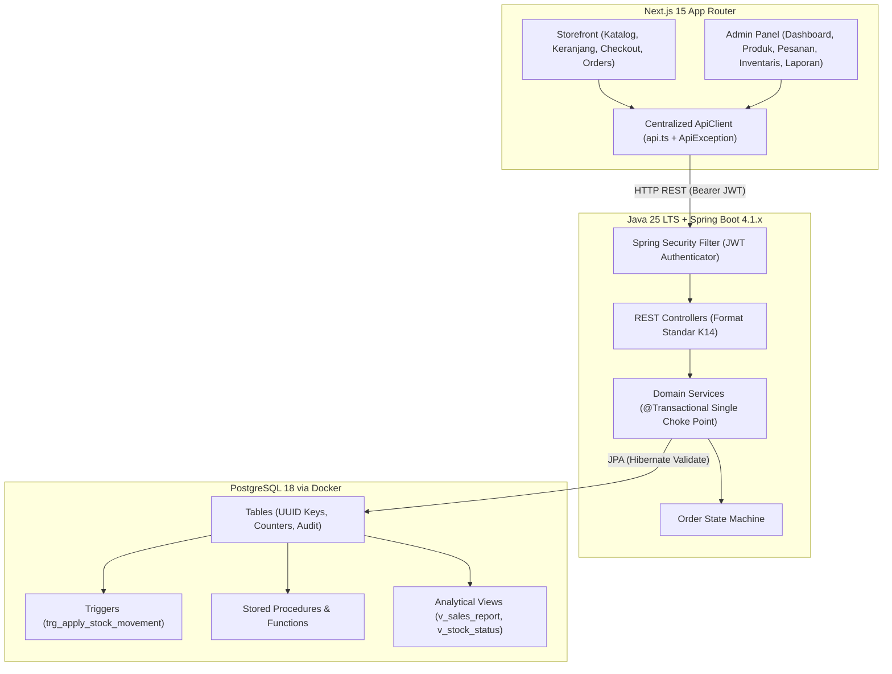

# ENSTEINSTORE 🌧️🧵

> **E-Commerce & Sales Management Web Application — Toko Enstein**  
> *"Your Trusted Store for Rainwear Materials and Accessories."*  
> **Final Project Semester 3:** Pemrograman Berorientasi Objek (PBO) & Basis Data — Kelompok 05  

[](https://spring.io/projects/spring-boot)
[](https://www.oracle.com/java/)
[](https://www.postgresql.org/)
[](https://nextjs.org/)
[](https://www.typescriptlang.org/)
[](https://tailwindcss.com/)
[](#-pengujian-testing)

---

## 📌 Tentang Project

**ENSTEINSTORE** adalah aplikasi web e-commerce dan manajemen penjualan terintegrasi yang dirancang untuk mendigitalkan seluruh proses bisnis **Toko Enstein** — toko retail fisik spesialis penyedia bahan baku pembuatan jas hujan (kain/material PVC berbagai ketebalan, parasit, mikron) beserta perlengkapan dan aksesoris konveksi pendukungnya (kancing snap resin, zipper/resleting waterproof, karet elastik, tali hoodie, lobi-lobi stopper, skotlet reflektor safety rider, hingga seam sealing tape silen mantel).

Aplikasi dibangun menggunakan **Arsitektur Tiga Lapisan Ketat (Strict Three-Tier)** di mana seluruh logika bisnis, validasi stok anti-minus, kalkulasi harga berpresisi tinggi (`BigDecimal`), dan otorisasi keamanan dijalankan secara otoritatif pada layer backend Java 25 & PostgreSQL 18.

---

## ✨ Fitur Utama Sistem

### 🛍️ 1. Storefront (Customer Portal)
- **Katalog & Detail Produk:** Eksplorasi bahan kain jas hujan (dengan dukungan kuantitas desimal/meter) dan aksesoris (satuan integer/pcs/roll).
- **Keranjang Belanja Real-Time:** Sinkronisasi multi-item cart berbasis database terpusat.
- **Multi-Step Checkout:** Pilihan metode pengiriman (*Delivery* / *Pickup*) dan metode pembayaran (*Bank Transfer*, *Cash*, *Simulated*).
- **Tracking & Riwayat Pesanan:** Pelacakan linimasa status pesanan (*PENDING_PAYMENT* $\rightarrow$ *PROCESSING* $\rightarrow$ *SHIPPED* / *READY_FOR_PICKUP* $\rightarrow$ *COMPLETED*).
- **Manajemen Pembayaran:** Upload bukti transfer fisik atau simulasi pembayaran instan demo.

### 📊 2. Back-Office (Admin & POS Kasir Toko)
- **Executive Dashboard:** Ringkasan metrik harian/bulanan yang dieksekusi secara konkuren melalui `CompletableFuture` (Sales, Stock Health, Recent Orders).
- **Manajemen Katalog & Produk:** Operasi CRUD produk lengkap dengan status featured, snapshot data, dan soft delete.
- **Kontrol Inventaris (Single Choke Point):** Pencatatan barang masuk (*Stock-In*) via Stored Procedure dan penyesuaian stok fisik (*Stock Opname Adjustment*) dengan validasi alasan.
- **Verifikasi Pembayaran:** Modal inspeksi berkas bukti transfer dengan tombol persetujuan atau penolakan transaksi.
- **Kasir Penjualan Toko Fisik (POS Offline Sales):** Modul kasir kas langsung yang memotong stok fisik seketika dalam satu transaksi ACID.
- **Laporan Finansial & Inventaris CSV:** Streaming berkas CSV aman (terlindungi dari CSV Injection) untuk penjualan harian, bulanan, produk terlaris, dan rekapitulasi stok.

---

## 🏛️ Arsitektur Tiga Lapisan (Strict Three-Tier)



---

## 📚 Kepatuhan Akademik (RPS PBO & Basis Data)

Dokumentasi detail pemenuhan Capaian Pembelajaran Lulusan (CPL) tersedia pada:
- 👉 **[docs/rps-compliance.md](docs/rps-compliance.md)** — Pemenuhan komprehensif RPS PBO & Basis Data.
- 👉 **[docs/architecture.md](docs/architecture.md)** — Arsitektur teknis 3-tier dan single choke point inventory.
- 👉 **[docs/class-diagram.md](docs/class-diagram.md)** — Diagram UML Class domain OOP (Inheritance, Strategy Pattern, State Machine).
- 👉 **[docs/testing.md](docs/testing.md)** — Matriks keterlacakan 30 Test Cases (TC-01 s/d TC-30).
- 👉 **[docs/api-documentation.md](docs/api-documentation.md)** — Kontrak REST API dan skema request/response.

---

## 🚀 Panduan Menjalankan Sistem (Getting Started)

### Prasyarat Perangkat Lunak
- **Docker Desktop** (Engine aktif untuk PostgreSQL 18)
- **Java 25 LTS JDK**
- **Node.js 18+** & `npm`

### 1. Menjalankan Database PostgreSQL
Jalankan kontainer database melalui Docker Compose:
```powershell
docker-compose up -d
```
Verifikasi kontainer berjalan sehat:
```powershell
docker ps
```

### 2. Menjalankan Backend Spring Boot
Masuk ke direktori `backend` dan jalankan aplikasi:
```powershell
cd backend
./mvnw spring-boot:run
```
- Layanan REST API aktif di: `http://localhost:8080`
- Dokumentasi Interaktif Swagger OpenAPI: `http://localhost:8080/swagger-ui.html`
- Healthcheck Actuator: `http://localhost:8080/actuator/health`

### 3. Menjalankan Frontend Next.js
Buka terminal baru, masuk ke direktori `frontend` dan jalankan mode pengembangan:
```powershell
cd frontend
npm install
npm run dev
```
- Buka antarmuka aplikasi di peramban: `http://localhost:3000`

---

## 🔐 Kredensial Pengujian Bawaan (Default Seed Data)

| Role | Email | Password | Hak Akses |
|---|---|---|---|
| **Admin / Owner** | `admin@ensteinstore.com` | `EnsteinAdmin2026!` | Akses penuh dashboard, produk, pesanan, inventaris, POS kasir, dan laporan |
| **Customer Default** | `budi@test.com` | `Budi123!` | Akses katalog, keranjang belanja, checkout, dan riwayat pesanan |

---

## 🧪 Pengujian (Testing)

Proyek ini dilengkapi dengan suite pengujian komprehensif (40/40 Automated Tests Lulus):

```powershell
# 1. Menjalankan Unit Tests (Surefire)
cd backend
./mvnw test

# 2. Menjalankan Integration Tests Lengkap (Testcontainers PostgreSQL 18)
cd backend
./mvnw verify

# 3. Menjalankan Validasi End-to-End 13 Skenario Bisnis
powershell -ExecutionPolicy Bypass -File scratch/test_e2e_full.ps1

# 4. Memverifikasi Build Produksi Frontend
cd frontend
npm run build
```

---

## 👥 Pengembang (Kelompok 05)

- **Proyek:** Final Project PBO & Basis Data Semester 3
- **Institusi:** Program Studi Informatika
- **Tahun:** 2026
