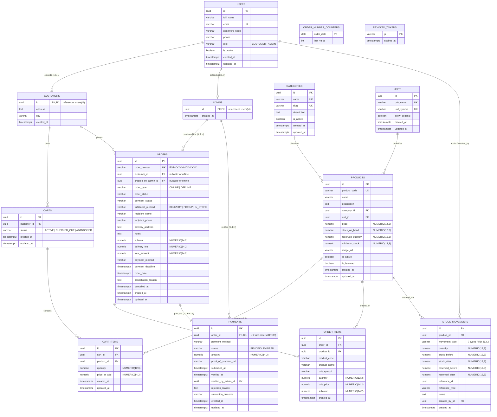

# ENSTEINSTORE — Entity Relationship Diagram (ERD)

Mermaid diagram di bawah memodelkan seluruh relasi tabel dalam skema basis data PostgreSQL 18 untuk Toko Enstein, mematuhi prinsip 3-Tier Architecture, 3NF, dan batasan PRD §13.

## Relasi dan Aturan Integritas
1. **Inheritance Pengguna (Table-per-Type):** `users` adalah tabel dasar, sedangkan `customers` dan `admins` berbagi PK yang sama sebagai FK (`ON DELETE CASCADE`).
2. **Koleksi Keranjang Tunggal Aktif:** Terdapat Partial Unique Index pada `carts(customer_id) WHERE status = 'ACTIVE'`.
3. **Pencegahan Item Duplikat:** Unique index `(cart_id, product_id)` dan `(order_id, product_id)`.
4. **Relasi 1:1 Pembayaran:** `payments.order_id` bersifat `UNIQUE` (BR-05).
5. **Audit Trail Mutasi Stok (Immutable):** `stock_movements` bersifat *append-only*. Trigger menolak instruksi `UPDATE` atau `DELETE`.
