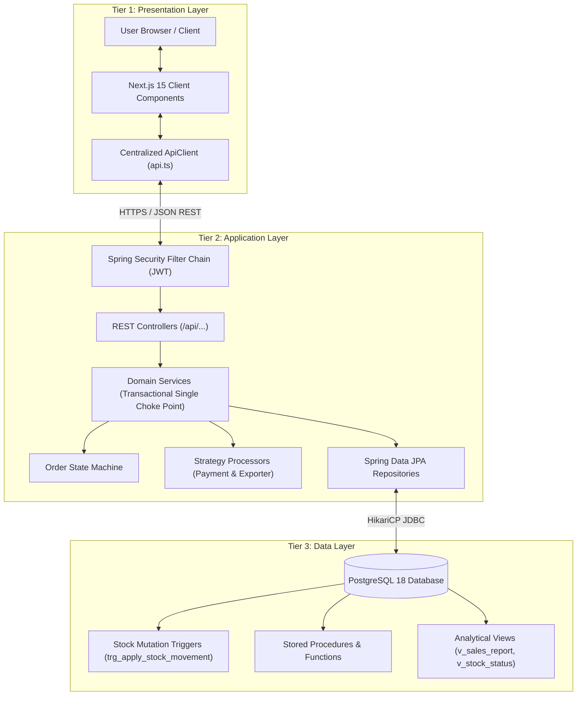
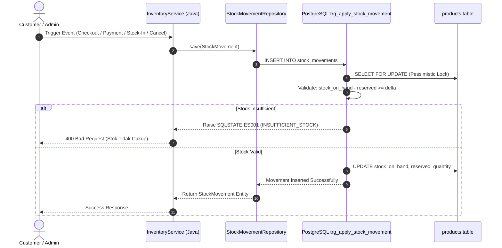
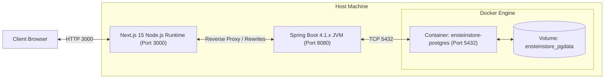

# ENSTEINSTORE — Architecture Documentation

**System:** ENSTEINSTORE (Toko Enstein Web Application)  
**Type:** Single-Seller E-Commerce & Point of Sales (POS) for Raincoat Materials & Accessories  
**Technology Stack:** Next.js 15 (TypeScript, Tailwind CSS), Java 25 LTS, Spring Boot 4.1.x, PostgreSQL 18, Docker  
**Architectural Pattern:** Strict Three-Tier Architecture, Single Choke Point Inventory, Strategy Pattern, State Machine  

---

## 1. Architectural Overview & System Tiers

ENSTEINSTORE follows an uncompromising Three-Tier Architecture adhering strictly to Rule #1 and Rule #2 of `AGENTS.md`:
1. **Presentation Layer (Next.js 15 App Router):**
   - Pure presentation. All pricing, discounts, stock availability checks, order state validation, and authorization are authoritative in the backend.
   - Built with React 19, TypeScript, and Tailwind CSS.
   - Centralized HTTP client ([frontend/src/lib/api.ts](file:///e:/Folder%20Tugas-Q/SEMESTER%203/ENSTEINSTORE/frontend/src/lib/api.ts)) handles authentication tokens, file uploads, CSV streaming, and translates K14 structured backend errors into intuitive UI alerts.
2. **Application / Business Layer (Java 25 LTS & Spring Boot 4.1.x):**
   - Encapsulates all domain entities, validation logic, transaction boundaries (`@Transactional`), security authorization, and state transitions.
   - Modular packaging: `config/`, `controller/`, `dto/`, `entity/`, `exception/`, `exporter/`, `payment/`, `repository/`, `security/`, `service/`, `util/`.
   - Never exposes JPA entities directly across controllers; strict DTO mapping prevents Mass Assignment vulnerabilities.
3. **Data Layer (PostgreSQL 18 via Docker / Local):**
   - Single source of persistent truth.
   - Version-controlled schema migrations via Flyway (`V1` through `V14`).
   - `spring.jpa.hibernate.ddl-auto=validate` guarantees schema integrity without runtime modifications by Hibernate.
   - Business rules enforced at database level through triggers, unique functional indexes, stored procedures, and views.



---

## 2. Core Architectural Pillars

### 2.1 Single Choke Point Inventory Architecture (Rule #7)
Stock mutations are the most critical business invariant in an e-commerce platform. In ENSTEINSTORE:
- Java application code **NEVER** executes `UPDATE products SET stock_on_hand = ...` or `reserved_quantity = ...` directly.
- The exclusive gateway for any stock modification is `INSERT INTO stock_movements` handled through `InventoryService`.
- A PostgreSQL database trigger `trg_apply_stock_movement` intercepts the insertion:
  1. Acquires a pessimistic lock on the target product row (`FOR UPDATE`).
  2. Verifies stock availability (preventing negative available stock: `stock_on_hand - reserved_quantity >= 0`).
  3. Mutates `stock_on_hand` and `reserved_quantity` atomically according to the `movement_type`.
  4. Automatically records before and after snapshots.
  5. Immutability trigger `trg_prevent_movement_mutation` forbids `UPDATE` or `DELETE` on `stock_movements`.



### 2.2 OOP Design Patterns (PRD §19.1)
1. **Inheritance & Polymorphism:**
   - Base abstract class `User` extended by `Customer` and `Admin`.
   - Polymorphic method `getRole()` returns proper security authorities.
   - Joined table inheritance strategy isolates administrative metadata from customer shopping profiles.
2. **Strategy Pattern for Payments:**
   - Common interface: `PaymentProcessor`.
   - Concrete implementations:
     - `ManualTransferProcessor`: Validates receipt uploads, generates bank account details, and routes to admin verification.
     - `SimulatedPaymentProcessor`: Provides mock instant settlement for demo and integration testing.
     - `CashPaymentProcessor`: Instantly settles in-store cash transactions for cashier POS.
3. **Strategy Pattern for Report Exporting:**
   - Common interface: `ReportExporter`.
   - Concrete implementation: `CsvReportExporter` streams CSV with defensive sanitization (anti-CSV injection) and UTF-8 encoding.
4. **Finite State Machine for Order Lifecycle:**
   - Centralized `OrderStateMachine` acts as the single source of truth for valid order status transitions:
     - `PENDING_PAYMENT` $\rightarrow$ `PROCESSING` (on payment confirmation) or `CANCELLED`.
     - `PROCESSING` $\rightarrow$ `SHIPPED` (for Delivery) or `READY_FOR_PICKUP` (for Pickup) or `CANCELLED`.
     - `SHIPPED` / `READY_FOR_PICKUP` $\rightarrow$ `COMPLETED`.
     - Terminal states (`COMPLETED`, `CANCELLED`) cannot transition to any other status.

### 2.3 Concurrency & Anti-Race Condition Guards
- **Pessimistic Locking:** Checkout locks product rows ordered by ID (`PESSIMISTIC_WRITE`) to avoid deadlocks when multiple users purchase overlapping items concurrently.
- **Atomic Order Numbering:** Sequence format `EST-YYYYMMDD-XXXX` generated via `order_number_counters` table using atomic `INSERT ... ON CONFLICT DO UPDATE ... RETURNING`.
- **Idempotency Guard:** Payment verifications lock payment rows `FOR UPDATE` ensuring simultaneous duplicate clicks result in only one execution.
- **Multithreading:** `DashboardService` executes 3 heavy summary queries (Sales metrics, Stock health, Recent orders) concurrently using `CompletableFuture` with a bounded custom thread pool executor.

---

## 3. Security Architecture

1. **Authentication:**
   - Stateless JWT authentication signed with HMAC-SHA256 (`alg: HS256`).
   - Token payload includes Subject (`userId`), Role (`CUSTOMER` or `ADMIN`), and unique JWT ID (`jti`).
   - Password encryption uses `BCryptPasswordEncoder` with strength factor 10.
2. **Authorization & RBAC:**
   - Method-level security enabled with `@EnableMethodSecurity`.
   - Customer endpoints secured with `@PreAuthorize("hasRole('CUSTOMER')")`.
   - Admin endpoints secured with `@PreAuthorize("hasRole('ADMIN')")`.
   - Ownership validation ensures customers cannot query or mutate orders belonging to other users.
3. **Token Invalidation (Logout):**
   - Active tokens invalidated upon logout by saving their `jti` and expiration timestamp to `revoked_tokens` table.
   - Pre-filter checks prevent revoked tokens from being reused.
4. **Standardized Error Handling (K14 Format):**
   - Global `@RestControllerAdvice` catches all exceptions, preventing internal stack traces from leaking to client responses.
   - Structured JSON response:
     ```json
     {
       "timestamp": "2026-11-22T13:45:00Z",
       "status": 400,
       "error": "Bad Request",
       "code": "INSUFFICIENT_STOCK",
       "message": "Stok produk tidak mencukupi untuk pesanan Anda.",
       "path": "/api/checkout",
       "fieldErrors": []
     }
     ```

---

## 4. Data Layer Architecture & Views

### Database Views:
- **`v_sales_report`:** Consolidates online and offline sales aggregations grouped by date and payment method.
- **`v_product_sales`:** Aggregates cumulative sales quantities, gross revenue, and distinct transaction counts per product.
- **`v_stock_status`:** Real-time visibility into `stock_on_hand`, `reserved_quantity`, `available_stock`, and reorder warnings.
- **`v_best_selling`:** Ranks top products by volume sold across a 30-day rolling window.

---

## 5. Deployment Topology


