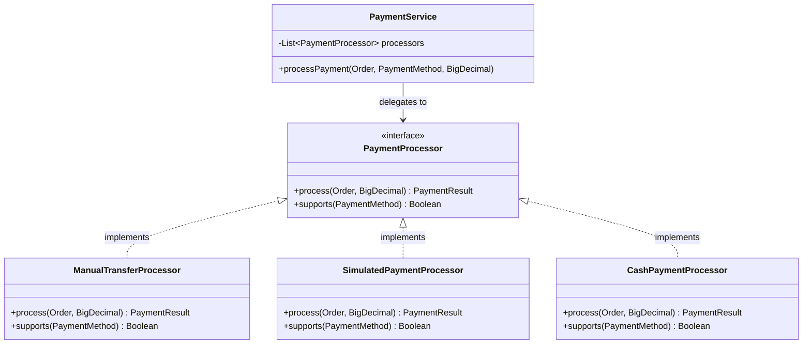
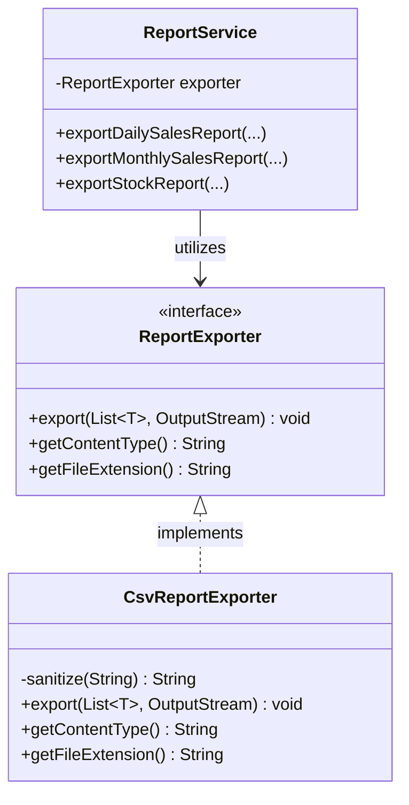
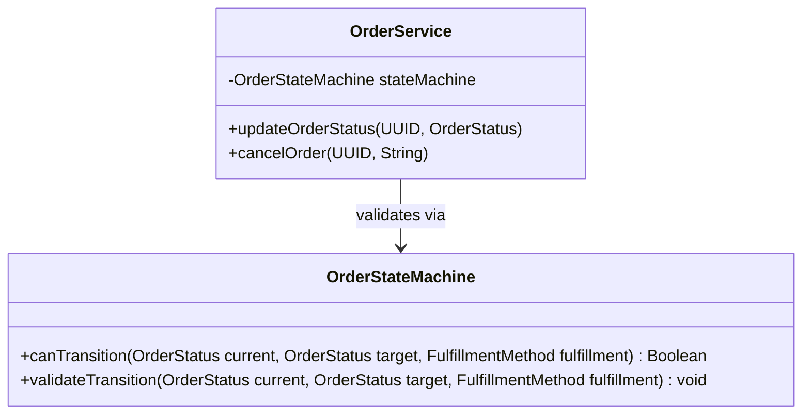

# ENSTEINSTORE — UML Class Diagram & Domain Model Documentation

**System:** ENSTEINSTORE (Toko Enstein Web Application)  
**Academic Alignment:** Pemrograman Berorientasi Objek (PBO) — PRD §19.1  
**Patterns:** Inheritance, Polymorphism, Encapsulation, Strategy Pattern, Finite State Machine  

---

## 1. Core Domain Model Class Diagram

The following Mermaid diagram visualizes the Object-Oriented structure of ENSTEINSTORE, highlighting inheritance hierarchies, composition, and associations.

```mermaid
classDiagram
    direction TB

    %% User Hierarchy (Inheritance & Polymorphism)
    class User {
        <<abstract>>
        -UUID id
        -String email
        -String passwordHash
        -String fullName
        -String phone
        -Boolean isActive
        -OffsetDateTime createdAt
        -OffsetDateTime updatedAt
        +getRole()* UserRole
        +getId() UUID
        +getEmail() String
        +getFullName() String
        +getPasswordHash() String
    }

    class Customer {
        -String defaultShippingAddress
        -OffsetDateTime lastLoginAt
        +getRole() UserRole
        +getDefaultShippingAddress() String
        +setDefaultShippingAddress(String)
    }

    class Admin {
        -String employeeNumber
        -String department
        +getRole() UserRole
        +getEmployeeNumber() String
        +getDepartment() String
    }

    User <|-- Customer : extends
    User <|-- Admin : extends

    %% Catalog & Product Entities
    class Category {
        -UUID id
        -String name
        -String slug
        -String description
        -OffsetDateTime createdAt
        +getId() UUID
        +getName() String
        +getSlug() String
    }

    class Unit {
        -UUID id
        -String name
        -String symbol
        -Boolean allowDecimal
        +getId() UUID
        +getName() String
        +isAllowDecimal() Boolean
    }

    class Product {
        -UUID id
        -String productCode
        -String name
        -String description
        -BigDecimal unitPrice
        -BigDecimal stockOnHand
        -BigDecimal reservedQuantity
        -BigDecimal minimumStock
        -String imageUrl
        -Boolean isActive
        -Boolean isFeatured
        -Category category
        -Unit unit
        +getAvailableStock() BigDecimal
        +isLowStock() Boolean
        +isOutOfStock() Boolean
    }

    Product --> Category : belongs to
    Product --> Unit : measured in

    %% Cart Entities
    class Cart {
        -UUID id
        -Customer customer
        -OffsetDateTime createdAt
        -OffsetDateTime updatedAt
        -List~CartItem~ items
        +addItem(Product, BigDecimal)
        +removeItem(UUID)
        +clear()
        +getTotalPrice() BigDecimal
    }

    class CartItem {
        -UUID id
        -Cart cart
        -Product product
        -BigDecimal quantity
        +getSubtotal() BigDecimal
    }

    Cart "1" *-- "0..*" CartItem : contains
    CartItem --> Product : references
    Customer "1" -- "1" Cart : owns

    %% Order & Payment Entities
    class Order {
        -UUID id
        -String orderNumber
        -Customer customer
        -OrderStatus orderStatus
        -PaymentMethod paymentMethod
        -FulfillmentMethod fulfillmentMethod
        -OrderChannel channel
        -BigDecimal subtotal
        -BigDecimal deliveryFee
        -BigDecimal totalAmount
        -String recipientName
        -String recipientPhone
        -String deliveryAddress
        -String notes
        -OffsetDateTime paymentDeadline
        -OffsetDateTime cancelledAt
        -List~OrderItem~ items
        -Payment payment
        +canCancel() Boolean
        +isExpired() Boolean
    }

    class OrderItem {
        -UUID id
        -Order order
        -Product product
        -String productNameSnapshot
        -String productCodeSnapshot
        -BigDecimal unitPriceSnapshot
        -BigDecimal quantity
        -BigDecimal subtotal
    }

    class Payment {
        -UUID id
        -Order order
        -PaymentMethod paymentMethod
        -BigDecimal amount
        -PaymentStatus paymentStatus
        -String proofImageUrl
        -OffsetDateTime paidAt
        -OffsetDateTime verifiedAt
        -Admin verifiedBy
        -String rejectionReason
        +isSettled() Boolean
    }

    Order "1" *-- "1..*" OrderItem : contains
    OrderItem --> Product : snapshots
    Order "1" -- "1" Payment : requires
    Customer "1" -- "0..*" Order : places
    Admin "0..1" -- "0..*" Payment : verifies

    %% Inventory Stock Movement
    class StockMovement {
        -UUID id
        -Product product
        -MovementType movementType
        -BigDecimal quantity
        -BigDecimal stockOnHandBefore
        -BigDecimal stockOnHandAfter
        -BigDecimal reservedBefore
        -BigDecimal reservedAfter
        -Order referenceOrder
        -User createdBy
        -String notes
        -OffsetDateTime createdAt
    }

    StockMovement --> Product : mutates
    StockMovement --> Order : references
    StockMovement --> User : logged by
```

---

## 2. Design Pattern Implementations

### 2.1 Strategy Pattern: Payment Processing
Decouples payment verification and processing across different channels without modifying order checkout logic.

### 2.2 Strategy Pattern: Report Exporting
Isolates file format rendering, memory streaming, and anti-injection defenses from analytical data querying.

### 2.3 Finite State Machine: Order Lifecycle
Encapsulates state transitions according to PRD §11 rules, ensuring orders cannot skip or perform illegal transitions.

---

## 3. Academic Alignment (PBO Course Competencies)

| PBO Competency | Class Diagram Evidence & Implementation |
|---|---|
| **Encapsulation** | All entity fields are private; state access and mutations are guarded by public getters and business methods (e.g. `Product.getAvailableStock()`). |
| **Inheritance** | Base abstract class `User` extended by `Customer` and `Admin` using JPA Joined Table inheritance. |
| **Polymorphism** | Abstract method `getRole()` dynamically invoked to resolve security authorities depending on whether the principal is a `Customer` or `Admin`. |
| **Abstraction & Interfaces** | `PaymentProcessor`, `ReportExporter`, and Spring Data `JpaRepository` interfaces establish loose coupling and modular separation. |
| **Composition & Aggregation** | `Cart` strictly owns `CartItem` (Composition), while `Product` is referenced across `CartItem` and `OrderItem` (Aggregation). |
| **State Pattern / FSM** | Order lifecycle governed by `OrderStateMachine` with strict transition guards preventing unauthorized terminal state reversals. |
