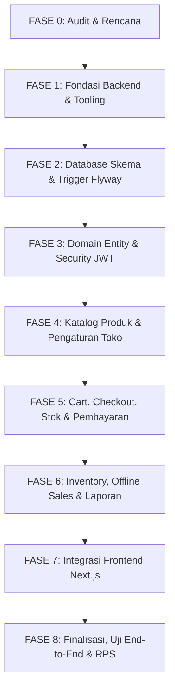

# ENSTEINSTORE — Master Implementation Plan

Dokumen ini memetakan seluruh tahapan pembangunan sistem ENSTEINSTORE dari Fase 0 hingga Fase 8, termasuk kriteria penerimaan, alokasi Test Case (TC-01 s/d TC-30), arsitektur modular, dan kriteria gerbang (Gate) yang harus dipenuhi sebelum beralih ke fase berikutnya.

---

## 1. Rencana Fase & Milestone Pelaksanaan

---

## 2. Rincian Pekerjaan Per Fase

### FASE 0 — Audit & Rencana (Current Phase)
- **Tujuan:** Analisis mendalam terhadap PRD, codebase frontend, assets, dan kesiapan environment lokal.
- **Deliverables:**
  - `docs/DECISIONS.md` (Resolusi K1–K14 + Temuan D15–D21).
  - `docs/api-documentation.md` (Kerangka kontrak REST API).
  - `AGENTS.md` (Aturan AI Coding Agent & Larangan Arsitektural).
  - `docs/implementation-plan.md` (Dokumen ini).
- **Gate:** Pengguna menyetujui rencana kerja Fase 0.

---

### FASE 1 — Fondasi Backend & Tooling
- **Tujuan:** Membangun struktur proyek Spring Boot 4 modular dengan Java 25 LTS, build tool Maven, konfigurasi Docker Compose untuk PostgreSQL 18, dan pondasi keamanan dasar.
- **Tugas Utama:**
  1. Struktur folder `backend/`: `src/main/java/com/ensteinstore`, `src/main/resources`, `src/test/java`.
  2. Setup `pom.xml` dengan starter modular Spring Boot 4.1.2:
     - `spring-boot-starter-webmvc`
     - `spring-boot-starter-data-jpa`
     - `spring-boot-starter-validation`
     - `spring-boot-starter-security`
     - `spring-boot-starter-actuator`
     - `spring-boot-starter-oauth2-resource-server` + Nimbus JOSE JWT
     - `org.postgresql:postgresql`
     - `org.flywaydb:flyway-database-postgresql`
     - `org.springdoc:springdoc-openapi-starter-webmvc-ui`
     - `org.testcontainers:postgresql` + `junit-jupiter`
  3. Konfigurasi `docker-compose.yml` di root untuk container `postgres:18-alpine` dengan volume persisten dan healthcheck.
  4. Konfigurasi `application.yml` (multi-profile: `dev`, `test`, `prod`), `application-dev.yml`, dan `application-test.yml`.
  5. Setup `.env.example` dan update `.gitignore` (memastikan file `.env` tidak ter-track).
  6. Handler error global `@RestControllerAdvice` format K14 (`code`, `fieldErrors`, pesan Bahasa Indonesia).
  7. Konfigurasi CORS terpusat (`WebMvcConfigurer`) membaca `app.cors.allowed-origins`.
  8. Actuator endpoint `/actuator/health` terbuka untuk monitoring status service.
- **Gate:**
  - Build `./mvnw compile verify` sukses tanpa error kompilasi.
  - Endpoint `GET /actuator/health` mengembalikan status `UP`.

---

### FASE 2 — Database Skema, Trigger & Lanjutan (Flyway V1–V13)
- **Tujuan:** Mengimplementasikan skema database PostgreSQL 18 murni melalui migrasi Flyway dengan constraint integritas ACID, trigger stok atomik, stored procedure, function, views, dan seed awal.
- **Tugas Utama:**
  1. **V1__create_users.sql:** tabel `users`, `customers`, `admins` (table per subclass), `revoked_tokens`.
  2. **V2__create_categories_units.sql:** tabel `categories`, `units`.
  3. **V3__create_products.sql:** tabel `products` (termasuk `is_featured`, constraint stok, snapshot).
  4. **V4__create_carts.sql:** tabel `carts` (partial unique index 1 active per customer) dan `cart_items` (unique cart_id + product_id).
  5. **V5__create_orders.sql:** tabel `orders` (`notes`, `payment_deadline`, `cancelled_at`, constraint channel offline/online), `order_items`, `order_number_counters`.
  6. **V6__create_payments.sql:** tabel `payments` (unique `order_id`, amount numeric, proof_url, status).
  7. **V7__create_stock_movements.sql:** tabel `stock_movements` (immutable, snapshot before/after, 7 movement types, unique index idempotensi).
  8. **V8__create_views.sql:** `v_sales_report`, `v_product_sales`, `v_stock_status`, `v_best_selling`.
  9. **V9__create_functions.sql:** `fn_order_total(UUID)`.
  10. **V10__create_procedures.sql:** `sp_record_stock_in(product_id, qty, admin_id, note)`.
  11. **V11__create_triggers.sql:**
      - `trg_product_updated_at` (`set_updated_at()`).
      - `trg_apply_stock_movement` (sebelum insert stock_movements: lock row `FOR UPDATE`, validasi stok cukup, mutasikan `stock_on_hand` dan `reserved_quantity`, cegah minus, lempar SQLSTATE `ES001`).
      - `trg_guard_product_stock` (menolak update langsung kolom stok di `products` kecuali session flag `app.stock_mutation = 'on'`).
      - `trg_prevent_movement_mutation` (menolak UPDATE atau DELETE pada tabel `stock_movements`).
  12. **V12__create_indexes.sql:** index fungsional, index FK, `idx_product_name`, `idx_order_date`.
  13. **V13__seed_initial_data.sql:** seed 5 kategori, 3 unit, 11 produk (menggunakan path gambar yang tepat), akun admin default.
  14. Folder pelengkap akademik `database/`: `erd/`, `eerd/`, `relational-schema/`, `normalization/`, `queries/`, `sample-data/`.
  15. Pengujian DB via Testcontainers: uji anti-negatif, trigger immutability, atomisitas order number.
- **Gate:**
  - Migrasi Flyway dari database kosong berjalan 100% lancar.
  - `spring.jpa.hibernate.ddl-auto=validate` lolos tanpa mismatch skema.
  - Test SQL Testcontainers hijau.

---

### FASE 3 — Domain Model & Autentikasi (JWT & Profil)
- **Tujuan:** Implementasi hierarki OOP User (inheritance & polymorphism), Spring Security 7, JWT authentication, revokasi token saat logout, dan manajemen profil.
- **Tugas Utama:**
  1. Entity JPA: `abstract class User` dengan turunan `Customer` dan `Admin` (inheritance discriminator/join table per subclass).
  2. Implementasi enkripsi password `BCryptPasswordEncoder(cost = 10)`.
  3. Security Filter Chain: JWT Authentication Filter, verifikasi klaim (`sub`, `role`, `jti`), blacklist check tabel `revoked_tokens`.
  4. Repository JPA: `UserRepository`, `CustomerRepository`, `AdminRepository`, `RevokedTokenRepository`.
  5. `AuthService` & `AuthController`:
     - `POST /api/auth/register` (hanya role CUSTOMER).
     - `POST /api/auth/login` (generik 401 error message jika salah).
     - `POST /api/auth/logout` (blacklist jti token).
     - `GET /api/auth/me`
  6. `ProfileController`: `PUT /api/me`, `PUT /api/me/password`.
  7. Unit test & integration test untuk auth & otorisasi.
- **Test Case Terpenuhi:** **TC-01**, **TC-02**, **TC-03**, **TC-19**.
- **Gate:** Seluruh test auth & role restriction hijau.

---

### FASE 4 — Katalog Produk & Manajemen Produk Admin
- **Tujuan:** Menyediakan API katalog publik dengan pencarian, filter, sorting, status stok turunan, upload gambar aman, dan manajemen produk/kategori/satuan untuk admin.
- **Tugas Utama:**
  1. Entity `Category`, `Unit`, `Product` dengan kalkulasi ketersediaan stok (`stockOnHand - reservedQuantity`).
  2. `StoreConfigController`: endpoint `GET /api/store/config` (rekening toko, fee kirim, payment expiry, simulation flag).
  3. `ProductService` & `ProductController`:
     - `GET /api/products`: pencarian case-insensitive, filter category, sort terbaru/harga/populer, pagination.
     - `GET /api/products/{idOrCode}`: resolusi via UUID atau product code.
  4. `CategoryService` & `UnitService` (publik & admin).
  5. `AdminProductController`:
     - CRUD produk, upload gambar multipart (validasi magic bytes, ekstensi jpg/png/webp, nama UUID acak).
     - Soft delete `is_active=false` jika produk memiliki riwayat pesanan (TC-24).
  6. Unit test validasi desimal satuan (`allow_decimal`).
- **Test Case Terpenuhi:** **TC-04**, **TC-21**, **TC-22**, **TC-23**, **TC-24**.
- **Gate:** Test katalog, sorting, validasi desimal, dan upload gambar hijau.

---

### FASE 5 — Cart, Checkout, Stok & Transaksi Pembayaran
- **Tujuan:** Menjalankan alur transaksi e-commerce inti: reservasi stok atomik saat checkout, state machine order, integrasi 3 payment processor, dan background job pembatalan pesanan kedaluwarsa.
- **Tugas Utama:**
  1. `InventoryService`: satu-satunya pintu gerbang stok di Java (`reserve`, `finalizeSale`, `release`, `stockIn`, `adjust`, `offlineSaleOut`).
  2. `CartService` & `CartController`: operasi keranjang (validasi produk aktif BR-02, validasi stok BR-03, kalkulasi subtotal/total `BigDecimal`).
  3. `CheckoutService` & `OrderService`:
     - `POST /api/orders`: checkout 1 transaksi atomik (kunci row produk `PESSIMISTIC_WRITE` urut ID, reservasi stok via movement `ONLINE_RESERVE`, snapshot harga BR-04, nomor order atomik, payment status `PENDING`, cart status `CHECKED_OUT`).
     - Rollback total jika terjadi kegagalan di tengah jalan (TC-20).
  4. `PaymentProcessor` Strategy Pattern:
     - `ManualTransferProcessor` (upload bukti transfer, status `WAITING_VERIFICATION`).
     - `SimulatedPaymentProcessor` (demo bayar sukses -> `PAID` / gagal -> tetap `PENDING` dan reservasi utuh).
     - `CashPaymentProcessor` (tunai saat pickup / offline).
  5. `OrderStateMachine`: pengontrol transisi status pesanan (`PENDING_PAYMENT`, `PAID`, `PROCESSING`, `READY`, `COMPLETED`, `CANCELLED`).
  6. Pembatalan pesanan `POST /api/orders/{id}/cancel` (hanya `PENDING_PAYMENT`, melepaskan reservasi via `RESERVATION_RELEASE`).
  7. `@Scheduled` Expiry Job: memproses order yang melewati `payment_deadline` menggunakan `FOR UPDATE SKIP LOCKED` secara idempoten.
  8. Uji konkurensi (TC-18): multithreaded test dengan `CountDownLatch` untuk membuktikan 2+ pemesan berebut sisa stok tidak menyebabkan stok minus.
- **Test Case Terpenuhi:** **TC-05**, **TC-06**, **TC-07**, **TC-08**, **TC-09**, **TC-10**, **TC-11**, **TC-12**, **TC-13**, **TC-18**, **TC-20**, **TC-25**, **TC-26**, **TC-27**, **TC-30**.
- **Gate:** Seluruh pengujian checkout, konkurensi stok (TC-18), idempotensi (TC-25), dan rollback (TC-20) lulus 100%.

---

### FASE 6 — Inventory Lanjutan, Penjualan Offline, Dashboard & Laporan CSV
- **Tujuan:** Fitur manajemen gudang, stock in via Stored Procedure, penyesuaian stok, pencatatan penjualan langsung toko, dashboard multithreaded paralel, dan pelaporan dengan ekspor CSV.
- **Tugas Utama:**
  1. `AdminInventoryController`:
     - Stock In: memanggil `sp_record_stock_in` di PostgreSQL (FR-35).
     - Stock Adjustment: wajib alasan (TC-28), menghasilkan `ADJUSTMENT_IN` atau `ADJUSTMENT_OUT`.
     - Riwayat movement (filter produk, tipe, rentang tanggal).
  2. `OfflineSalesService` & `AdminOfflineSalesController`:
     - `POST /api/admin/offline-sales`: satu transaksi atomik mencatat order `OFFLINE`/`IN_STORE`/`COMPLETED`, payment `PAID`, mutasi stok `OFFLINE_SALE_OUT`.
  3. `DashboardService`:
     - Eksekusi paralel 3 ringkasan (Sales, Stock, Recent Orders) menggunakan `CompletableFuture` dan pool thread terkelola (PRD §19.1).
  4. `ReportService` & `CsvReportExporter`:
     - 4 jenis laporan (Sales Summary, Product Sales, Stock Audit, Transaction Report).
     - Ekspor file CSV via Java File I/O (`BufferedWriter`), encoding UTF-8, dengan sanitasi CSV Injection (sel berawalan `=+-@` diberi apostrof).
  5. Verifikasi konsistensi laporan: SUM order terbayar (online + offline) = Total Laporan Penjualan (TC-29).
- **Test Case Terpenuhi:** **TC-14**, **TC-15**, **TC-16**, **TC-17**, **TC-28**, **TC-29**.
- **Gate:** Seluruh test inventory, offline sales, dashboard paralel, dan akurasi laporan hijau.

---

### FASE 7 — Integrasi Frontend Next.js Penuh
- **Tujuan:** Menghubungkan seluruh antarmuka Next.js yang ada ke backend Spring Boot tanpa mengubah tampilan visual UI.
- **Tugas Utama:**
  1. Penambahan dependensi `@tanstack/react-query` dan `zod` di frontend.
  2. Setup environment `.env.local`: `NEXT_PUBLIC_API_BASE_URL=http://localhost:8080`.
  3. `src/lib/api-client.ts`: client fetch terpusat (header Authorization Bearer, auto-logout saat 401, error parser K14).
  4. `src/types/api.ts` & `src/lib/mappers.ts`: adapter tipe API ke UI (mis. `fullName` -> `name`, `order_number` tanpa prefix `#` saat kirim dan dengan `#` saat display di UI).
  5. `AuthProvider`: menggantikan mock `localStorage['ensteinstore_auth_user']` dengan token JWT terpusat dan endpoint `/api/auth/me`. Route guard berbasis role.
  6. `CartProvider`: koneksi ke backend cart untuk customer login. Badge navbar dan cart drawer sinkron dengan API.
  7. Integrasi seluruh halaman:
     - `/` (Home): data kategori & produk featured/new dari API.
     - `/products` & `/products/[id]`: search, filter, sort, pagination, detail produk aktif.
     - `/cart` & `/checkout`: data cart real-time, validasi stok, place order, prefill alamat dari profil.
     - `/orders` & `/orders/[id]`: riwayat & linimasa pesanan real.
     - `/orders/[id]/payment`: ambil rekening & expiry dari `/api/store/config`, upload bukti transfer via multipart, opsi simulasi demo.
     - Admin: `/admin/dashboard`, `/admin/products` (upload foto), `/admin/categories`, `/admin/orders`, `/admin/payments` (verifikasi/tolak), `/admin/inventory`, `/admin/inventory/movements`, `/admin/offline-sales`, `/admin/reports` (filter tanggal & tombol ekspor CSV).
  8. Perbaikan bug path aset gambar di disk & penghapusan duplikasi gambar.
  9. Verifikasi `npm run build` dan `npm run lint` hijau tanpa error.
- **Gate:** Seluruh halaman frontend terhubung API nyata, build Next.js lulus.

---

### FASE 8 — Finalisasi, Pengujian Menyeluruh (30/30 TC) & Dokumentasi RPS
- **Tujuan:** Verifikasi akhir seluruh skenario uji fungsional, performa, keamanan, dan kelengkapan bukti akademik RPS PBO & Basis Data.
- **Tugas Utama:**
  1. Matriks Keterlacakan 30 Test Case (TC-01 s/d TC-30) dipetakan ke nama class/method test.
  2. Audit keamanan OWASP (BOLA, IDOR pada order, sanitasi upload file, proteksi CSV injection, pembatasan CORS).
  3. Dokumentasi lengkap:
     - `docs/architecture.md` (arsitektur 3-tier, data flow).
     - `docs/testing.md` (instruksi dan laporan eksekusi test).
     - `docs/class-diagram.md` (UML class diagram domain OOP).
     - Bukti pemenuhan RPS PBO (§19.1) & RPS Basis Data (§19.2).
     - `README.md` komprehensif (panduan setup & running dari nol).
- **Gate:** 30/30 Test Case lulus, zero defect pada stok/transaksi/auth, dokumen lengkap.

---

## 3. Matriks Keterlacakan Test Case (TC-01 s/d TC-30)

| No | Test Case ID & Deskripsi | Fase Target | Modul / Layer Terkait |
|---|---|---|---|
| 1 | **TC-01:** Customer registrasi akun baru | Fase 3 | `AuthService`, `CustomerRepository` |
| 2 | **TC-02:** Login customer berhasil | Fase 3 | `AuthService`, `JwtTokenProvider` |
| 3 | **TC-03:** Login admin berhasil | Fase 3 | `AuthService`, `AdminRepository` |
| 4 | **TC-04:** Katalog produk menampilkan produk aktif | Fase 4 | `ProductService`, `ProductRepository` |
| 5 | **TC-05:** Tambah item produk ke cart | Fase 5 | `CartService`, `CartItemRepository` |
| 6 | **TC-06:** Ubah kuantitas item cart & subtotal | Fase 5 | `CartService` (BigDecimal) |
| 7 | **TC-07:** Hapus item dari cart | Fase 5 | `CartService` |
| 8 | **TC-08:** Checkout berhasil & stok terreservasi | Fase 5 | `CheckoutService`, `InventoryService` |
| 9 | **TC-09:** Checkout melebihi stok ditolak | Fase 5 | `CheckoutService` (InsufficientStock) |
| 10 | **TC-10:** Verifikasi transfer manual oleh admin -> PAID | Fase 5 | `PaymentService`, `InventoryService` |
| 11 | **TC-11:** Simulasi pembayaran sukses -> PAID | Fase 5 | `SimulatedPaymentProcessor` |
| 12 | **TC-12:** Simulasi pembayaran gagal -> stok tetap terreservasi | Fase 5 | `SimulatedPaymentProcessor` |
| 13 | **TC-13:** Pembatalan order pending -> reservasi dilepas | Fase 5 | `OrderService`, `InventoryService` |
| 14 | **TC-14:** Admin stock in menambah stok fisik | Fase 6 | `InventoryService`, Stored Procedure DB |
| 15 | **TC-15:** Pencatatan transaksi offline toko | Fase 6 | `OfflineSalesService`, `OrderService` |
| 16 | **TC-16:** Ringkasan dashboard multithreaded | Fase 6 | `DashboardService` (CompletableFuture) |
| 17 | **TC-17:** Ekspor laporan penjualan ke CSV | Fase 6 | `CsvReportExporter` (Java File I/O) |
| 18 | **TC-18:** Uji konkurensi (2+ customer rebutan stok) | Fase 5 | Concurrency Test (CountDownLatch) |
| 19 | **TC-19:** Akses customer ke endpoint admin ditolak | Fase 3 | Spring Security (`ROLE_ADMIN` guard) |
| 20 | **TC-20:** Rollback transaksi checkout saat terjadi error | Fase 5 | `@Transactional` Rollback Integration Test |
| 21 | **TC-21:** Kuantitas desimal pada satuan non-desimal ditolak | Fase 4 | `UnitValidationService` (FR-12) |
| 22 | **TC-22:** Kuantitas desimal (2.5 meter) pada kain diterima | Fase 4 | `UnitValidationService`, `CartService` |
| 23 | **TC-23:** Perubahan harga produk tidak mengubah order lama | Fase 4 | Snapshot `order_items.unit_price` |
| 24 | **TC-24:** Hapus produk yang memiliki transaksi = soft delete | Fase 4 | `ProductService` (`is_active = false`) |
| 25 | **TC-25:** Verifikasi pembayaran diklik dua kali tetap idempoten | Fase 5 | `PaymentService` (`SELECT ... FOR UPDATE`) |
| 26 | **TC-26:** Expiry job membatalkan pesanan kedaluwarsa | Fase 5 | `@Scheduled` Expiry Task (SKIP LOCKED) |
| 27 | **TC-27:** Customer dilarang mengakses order customer lain | Fase 5 | Resource Ownership Check (403/404) |
| 28 | **TC-28:** Penyesuaian stok tanpa alasan ditolak | Fase 6 | `InventoryService` Bean Validation |
| 29 | **TC-29:** Rekap laporan penjualan cocok 100% dengan total order | Fase 6 | `ReportService` Consistency Verification |
| 30 | **TC-30:** Transisi status order ilegal ditolak | Fase 5 | `OrderStateMachine` Validation |
