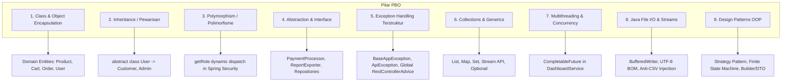

# ENSTEINSTORE — Academic Compliance & RPS Alignment

**Program Studi:** S1 Informatika / Sistem Informasi  
**Mata Kuliah:** Pemrograman Berorientasi Objek (PBO) & Basis Data  
**Proyek Aplikasi:** ENSTEINSTORE (Toko Enstein — Material Jas Hujan & Aksesori)  
**Tahun Akademik:** Semester 3 — 2026  

---

## 1. Pemenuhan Rencana Pembelajaran Semester (RPS) PBO

Berdasarkan silabus mata kuliah Pemrograman Berorientasi Objek (PBO) dan ketentuan PRD §19.1, aplikasi ENSTEINSTORE mengimplementasikan prinsip-prinsip fundamental dan lanjutan rekayasa perangkat lunak berorientasi objek:

### 1.1 Class, Object, dan Encapsulation
- Seluruh atribut/state pada domain model (`Product`, `Cart`, `Order`, `Payment`, `StockMovement`) bersifat `private`.
- Akses dan mutasi hanya diperbolehkan melalui getter/setter atau method bisnis otoritatif (misalnya `Product.getAvailableStock()`, `Order.canCancel()`).
- Data Transfer Objects (DTO) mengisolasi struktur entitas database dari client JSON, mencegah Mass Assignment vulnerabilities.

### 1.2 Inheritance (Pewarisan)
- **Hierarki User:**
  - Base class: `abstract class User` mendefinisikan atribut umum (`id`, `email`, `passwordHash`, `fullName`, `phone`, `isActive`, `createdAt`).
  - Subclass: `Customer` (menambah `defaultShippingAddress`, `lastLoginAt`) dan `Admin` (menambah `employeeNumber`, `department`).
  - Menggunakan strategi JPA `@Inheritance(strategy = InheritanceType.JOINED)` dengan tabel terpisah di PostgreSQL.

### 1.3 Polymorphism (Polimorfisme)
- Method abstrak `public abstract UserRole getRole()` pada `User` di-override secara spesifik oleh:
  - `Customer.getRole()` $\rightarrow$ mengembalikan `UserRole.CUSTOMER` (GrantedAuthority: `ROLE_CUSTOMER`).
  - `Admin.getRole()` $\rightarrow$ mengembalikan `UserRole.ADMIN` (GrantedAuthority: `ROLE_ADMIN`).
- Dynamic method dispatch digunakan secara transparan oleh Spring Security filter untuk otorisasi endpoint.

### 1.4 Abstraction & Interfaces
- **`PaymentProcessor`:** Interface abstraksi pemrosesan pembayaran dengan method `process(Order, BigDecimal)` dan `supports(PaymentMethod)`.
- **`ReportExporter`:** Interface abstraksi ekspor data dengan method `export(List<T>, OutputStream)`.
- **Spring Data Repositories:** Abstraksi akses data berbasis antarmuka generik (`JpaRepository<T, ID>`).

### 1.5 Exception Handling Terstruktur
- Hierarki exception berakar pada `BaseAppException` (`RuntimeException`):
  - `InsufficientStockException`, `ResourceNotFoundException`, `InvalidOrderStatusException`, `PaymentVerificationException`.
  - Global Handler `@RestControllerAdvice` menangkap seluruh exception dan menghasilkan format standar K14 Bahasa Indonesia semantik.

### 1.6 Multithreading & Asynchronous Processing
- **`DashboardService` (PRD §19.1):**
  - Menggunakan `CompletableFuture.supplyAsync()` dengan custom thread pool terkelola (`dashboardTaskExecutor`) untuk mengeksekusi 3 query berat secara konkuren:
    1. Perhitungan metrik penjualan harian dan bulanan (`v_sales_report`).
    2. Audit kesehatan stok produk (stok menipis / habis).
    3. Pengambilan transaksi pesanan terbaru.
  - Menggabungkan hasil melalui `CompletableFuture.allOf()` tanpa memblokir thread HTTP utama.

### 1.7 Java File I/O & Defensive Programming
- **`CsvReportExporter`:**
  - Menggunakan `BufferedWriter` dengan `OutputStreamWriter(StandardCharsets.UTF_8)` dan byte prefix UTF-8 BOM (`\uFEFF`) agar kompatibel dengan Microsoft Excel.
  - **Proteksi CSV Injection (CWE-1236):** Sel string yang berawalan karakter formula kalkulasi berbahaya (`=`, `+`, `-`, `@`, `\t`, `\r`) disanitasi secara otomatis dengan menambahkan prefix tanda petik tunggal (`'`).

---

## 2. Pemenuhan Rencana Pembelajaran Semester (RPS) Basis Data

Berdasarkan silabus mata kuliah Basis Data dan PRD §19.2, skema basis data ENSTEINSTORE dirancang memenuhi standar profesional perancangan database relasional:

### 2.1 Normalisasi Basis Data (1NF, 2NF, 3NF, BCNF)
1. **First Normal Form (1NF):**
   - Seluruh kolom bersifat atomik (tidak ada multivalued attribute atau composite array pada kolom data bisnis).
   - Setiap tabel memiliki Primary Key unik (`UUID` v4).
2. **Second Normal Form (2NF):**
   - Seluruh atribut non-key bergantung penuh secara fungsional pada Primary Key tabel, bukan pada bagian dari composite key.
3. **Third Normal Form (3NF):**
   - Menghilangkan ketergantungan transitif. Contoh: informasi unit satuan dan kategori produk dipisahkan ke tabel relasi master `units` dan `categories`.
4. **Boyce-Codd Normal Form (BCNF):**
   - Setiap ketergantungan fungsional $X \rightarrow Y$ memastikan bahwa $X$ adalah superkey.

### 2.2 Integritas Data & Constraint PostgreSQL 18
- **Domain Constraints:** Penggunaan tipe data presisi tinggi `NUMERIC(12,3)` untuk stok desimal dan `NUMERIC(15,2)` untuk mata uang rupiah.
- **Referential Integrity:** Hubungan Foreign Key dengan aksi cascading yang aman (`ON DELETE RESTRICT` pada produk berelasi pesanan untuk menjamin jejak audit transaksi).
- **Check Constraints:**
  - `chk_products_price`: `unit_price >= 0`
  - `chk_products_stock`: `stock_on_hand >= 0`
  - `chk_products_reserved`: `reserved_quantity >= 0`
  - `chk_order_total`: `total_amount >= 0`

### 2.3 Single Choke Point Trigger & Anti-Minus Stock
- **`trg_apply_stock_movement` (PRD Rule #7):**
  - Mencegah manipulasi stok langsung di luar tabel `stock_movements`.
  - Mengunci baris produk dengan `SELECT ... FOR UPDATE` untuk mencegah race condition.
  - Memvalidasi formula: `stock_on_hand - reserved_quantity >= kuantitas_reservasi`.
  - Jika stok tidak mencukupi, trigger membatalkan transaksi dengan melempar error code SQLSTATE `ES001`.
- **`trg_guard_product_stock`:**
  - Memblokir perintah `UPDATE products SET stock_on_hand = ...` langsung dari koneksi SQL mana pun kecuali session flag `app.stock_mutation = 'on'` diaktifkan secara internal oleh trigger.
- **`trg_prevent_movement_mutation`:**
  - Menolak mutasi `UPDATE` atau `DELETE` pada tabel `stock_movements`, menjamin data audit trail bersifat append-only (immutable).

### 2.4 Stored Procedures & Functions
- **`sp_record_stock_in(p_product_id, p_quantity, p_admin_id, p_notes)`:**
  - Stored Procedure untuk pencatatan kulakan/restock barang masuk dari supplier secara atomik.
- **`fn_order_total(p_order_id)`:**
  - Function PL/pgSQL untuk menghitung subtotal dan total pesanan langsung di layer database.

### 2.5 Views & Indexing Performance
- **Database Views:**
  - `v_sales_report`: Rekapitulasi agregasi penjualan harian/bulanan.
  - `v_product_sales`: Analisis produk terlaris berdasarkan kuantitas dan pendapatan.
  - `v_stock_status`: Monitoring level stok aman, minimum, dan indikator out-of-stock.
  - `v_best_selling`: Ranking produk terlaris dalam jendela waktu 30 hari terakhir.
- **Strategi Indexing:**
  - B-Tree index pada kolom pencarian (`products.product_code`, `products.name`).
  - Index pada kolom foreign key (`orders.customer_id`, `order_items.order_id`).
  - Partial Unique Index (`idx_carts_active_customer`) memastikan hanya ada tepat 1 keranjang aktif per customer.
  - Composite Index (`idx_orders_date_status`) mengoptimalkan query laporan penjualan rentang tanggal.

---

## 3. Matriks Pembuktian Akademik

| Komponen Silabus | Implementasi di ENSTEINSTORE | Lokasi Berkas Sumber Kode |
|---|---|---|
| **PBO: Encapsulation** | Private fields, immutable getters, DTO mapping | `backend/src/main/java/com/ensteinstore/entity/`, `dto/` |
| **PBO: Inheritance** | `abstract User` $\rightarrow$ `Customer`, `Admin` | `backend/src/main/java/com/ensteinstore/entity/` |
| **PBO: Polymorphism** | Polymorphic role resolution `getRole()` | `backend/src/main/java/com/ensteinstore/entity/` |
| **PBO: Strategy Pattern** | `PaymentProcessor`, `ReportExporter` | `backend/src/main/java/com/ensteinstore/payment/`, `exporter/` |
| **PBO: State Machine** | Strict order lifecycle state machine | `backend/src/main/java/com/ensteinstore/service/OrderStateMachine.java` |
| **PBO: Multithreading** | Parallel dashboard aggregations via `CompletableFuture` | `backend/src/main/java/com/ensteinstore/service/DashboardService.java` |
| **PBO: Defensive I/O** | Anti-CSV Injection, UTF-8 BOM, streaming output | `backend/src/main/java/com/ensteinstore/exporter/CsvReportExporter.java` |
| **DB: Normalization** | Skema 3NF/BCNF tabel relasional | `backend/src/main/resources/db/migration/V1` s/d `V7` |
| **DB: Atomic Triggers** | Single choke point inventory trigger `trg_apply_stock_movement` | `backend/src/main/resources/db/migration/V11__create_triggers.sql` |
| **DB: Immutability** | Trigger pelindung audit log mutasi stok | `backend/src/main/resources/db/migration/V11__create_triggers.sql` |
| **DB: Stored Procedure** | `sp_record_stock_in` restock procedure | `backend/src/main/resources/db/migration/V10__create_procedures.sql` |
| **DB: Analytical Views** | 4 Views analitik performa toko | `backend/src/main/resources/db/migration/V8__create_views.sql` |
| **DB: Performance Index** | Partial unique, composite, dan functional index | `backend/src/main/resources/db/migration/V12__create_indexes.sql` |
